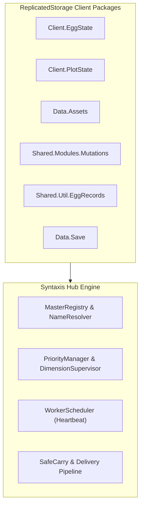
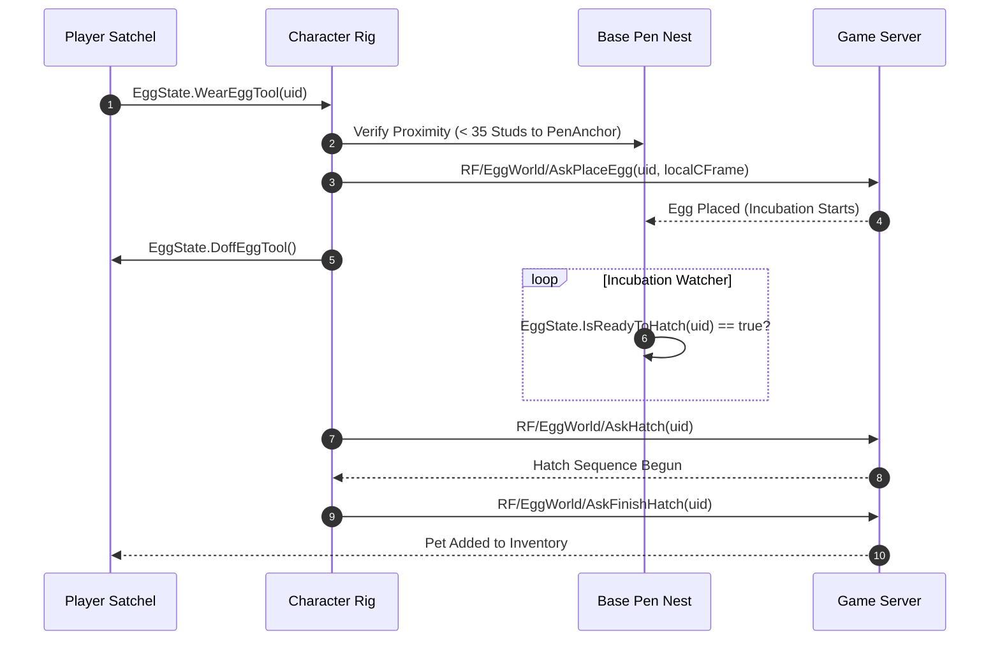

# SYNTAXIS HUB (`qualcom`) - PROJECT KNOWLEDGE BASE

> **Notice:** This document is the living knowledge repository for the Syntaxis Hub project. It contains all architectural decisions, reverse-engineered game mechanics, remote endpoints, algorithm designs, executor compatibility rules, priority systems, and known issues. **Every time new knowledge is discovered, implemented, or refactored, this document must be updated.**

---

## Table of Contents
1. [Project Overview & Multi-Repository Architecture](#1-project-overview--multi-repository-architecture)
2. [Platform & Universal Executor Compatibility Layer (`UniversalCompat`)](#2-platform--universal-executor-compatibility-layer-universalcompat)
3. [Client Engine Hooking & Game Module Architecture](#3-client-engine-hooking--game-module-architecture)
4. [Complete Network Remotes Catalog (93 Total)](#4-complete-network-remotes-catalog-93-total)
5. [Valuation Formulas, Scoring & Rarity Tiers](#5-valuation-formulas-scoring--rarity-tiers)
6. [Automation Engines & Core Subsystems](#6-automation-engines--core-subsystems)
   - 6.1 [Stealing & Delivery Engine](#61-stealing--delivery-engine)
   - 6.2 [Egg Placement & Incubation-Aware Hatching](#62-egg-placement--incubation-aware-hatching)
   - 6.3 [Pet Management, Satchel & Fusion Chamber](#63-pet-management-satchel--fusion-chamber)
   - 6.4 [Treadmill & Homestead Upgrades](#64-treadmill--homestead-upgrades)
   - 6.5 [Halloween Dimension & World Automations](#65-halloween-dimension--world-automations)
     - 6.5.1 [Halloween Dimension Rules & Autonomous Travel](#651-architectural-rules-halloween-event-2026--halloween-dimension)
   - 6.6 [Character Integrity, GodMode & Anti-Ragdoll](#66-character-integrity-godmode--anti-ragdoll)
7. [Unified Priority System & Concurrency Architecture](#7-unified-priority-system--concurrency-architecture)
8. [Anti-Cheat Detection Vectors & Hardening Guidelines](#8-anti-cheat-detection-vectors--hardening-guidelines)
9. [Commit History & Version Milestones](#9-commit-history--version-milestones)

---

## 1. Project Overview & Multi-Repository Architecture

### 1.1 Repositories & Distribution
- **Main Automation Script:** [`tenobarillas-ship-it/sae`](https://github.com/tenobarillas-ship-it/sae)
  - Primary script entry: `qualcom` (Luau script executed via standard Roblox `loadstring`).
  - Standalone loader:
    ```lua
    loadstring(game:HttpGet("https://raw.githubusercontent.com/tenobarillas-ship-it/sae/main/qualcom"))()
    ```
- **Modular GUI Library:** [`tenobarillas-ship-it/GUILib`](https://github.com/tenobarillas-ship-it/GUILib)
  - Liquid Glass iOS-inspired UI library cleanly separated from automation logic.
  - Modular distribution: `src/` (`Window`, `Components`, `Panels`, `Themes`, `Animations`, `Utils`, `Modals`).
  - Bundled single-request loader: `SyntaxisLib.lua`.
    ```lua
    local SyntaxisLib = loadstring(game:HttpGet("https://raw.githubusercontent.com/tenobarillas-ship-it/GUILib/main/SyntaxisLib.lua"))()
    ```
- **Reference Repository (Private):** [`tenobarillas-ship-it/friend`](https://github.com/tenobarillas-ship-it/friend)
  - Houses the monolithic 49,217-line reference script `chilihubstealanegg.lua`.
  - Used strictly for reverse engineering, remote discovery, and algorithm comparison.

### 1.2 Local Workspace & Settings Persistence
- **Local Working File:** `qualcom_clean.lua` (4,479 lines / 171 KB).
- **Settings Files (on executor):**
  - `SyntaxHubSettings.json` / `SyntaxHub_Config.json`: Persists UI states, toggles, filter dropdowns, and custom priority rankings via `readfile` / `writefile`.
  - `ChilliLibrary/SAE_Priority.json` (Reference implementation format).

---

## 2. Platform & Universal Executor Compatibility Layer (`UniversalCompat`)

### 2.1 Platform Breakdown: Mobile vs PC Executors
- **Delta Mobile (Android):** Employs full C-level closures for `fireproximityprompt(prompt, 0)` and `firetouchinterest(part1, part2, 0/1)`. Operates in a unified 32/64-bit ARM environment.
- **PC Executors (Wave, Synapse Z, Macsploit, Solara, Celery):**
  - **Proximity Prompts:** Often lack `fireproximityprompt` completely (`nil`), or accept only specific argument counts (`prompt, 0`), or throw exceptions if called without `pcall`. Direct engine calls (`prompt:InputHoldBegin()`) fail unless `RequiresLineOfSight` is disabled, distance checks pass, and hold durations are allowed at least 1-2 frames.
  - **Touch Interests:** Many budget PC executors have stubbed `firetouchinterest` implementations that do not replicate `Touched` events across distances. If a character hovers above a target (e.g. 14 studs), `firetouchinterest` does not hit unless the weapon handle physically intersects the target's bounding box.
  - **Button Clicks:** `getconnections` is frequently stubbed or lacks `:Fire()`. Official Roblox `VirtualInputManager` is required as a reliable engine fallback.

### 2.2 Universal Compatibility & Polyfill Layer (`UniversalCompat`)
All script automation modules route through `UniversalCompat` rather than making raw executor calls. It is engineered to be **100% Touch & Mobile-Safe** with zero synthetic input flags:

1. **`UniversalCompat.FireProximityPrompt(prompt)`**:
   - Matches the friend reference implementation (`chilihubstealanegg.lua` line 30064):
     ```lua
     local function FirePrompt(prompt)
         if prompt and type(fireproximityprompt) == "function" then
             pcall(function()
                 prompt.HoldDuration = 0
                 fireproximityprompt(prompt)
             end)
         end
     end
     ```
   - **Zero Property Tampering:** Never modifies `MaxActivationDistance` or `RequiresLineOfSight` on server-replicated prompts (which causes client/server property desync and triggers anti-tamper kicks).
   - **Zero VirtualInputManager:** Completely eliminates `VirtualInputManager:SendKeyEvent` simulation, avoiding synthetic keyboard event injection on touchscreen devices (Delta Android/iOS).
   - **Legitimate Physical Positioning:** The player character is positioned within interaction reach ($le 4$ studs) before firing, ensuring prompts trigger naturally within server distance boundaries.

2. **`UniversalCompat.FireTouch(part1, part2)`**:
   - **Method A:** Dual-stage `firetouchinterest(part1, part2, 0)` $
ightarrow$ `task.wait(0.01)` $
ightarrow$ `(part1, part2, 1)`.
   - **Method B:** Fallback ensures `CanTouch = true` on participating BaseParts.
   - Works uniformly across PC executors and mobile executors without raising execution exceptions.

3. **`UniversalCompat.ClickButton(btn)`**:
   - Pure event dispatching matching friend source (line 37655):
     1. `firesignal(btn.Activated)` / `firesignal(btn.MouseButton1Click)`
     2. `getconnections(btn.Activated)` loop invoking `c:Fire()` or `c.Function()`
     3. `getconnections(btn.MouseButton1Click)` loop invoking `c:Fire()` or `c.Function()`
   - **Zero MouseButtonEvent:** Avoids `VirtualInputManager:SendMouseButtonEvent` which fails or triggers security flags on pure touch environments where `UserInputService.MouseEnabled == false`.

### 2.3 Safe Container Parenting (`GetSafeParent`)
Roblox executors have varying levels of GUI protection and context permissions:
```lua
local safeContainer = nil
if typeof(gethui) == "function" then
    local ok, res = pcall(gethui)
    if ok and typeof(res) == "Instance" then safeContainer = res end
end
if not safeContainer then
    pcall(function()
        local cg = game:GetService("CoreGui")
        if cg and typeof(cg) == "Instance" then safeContainer = cg end
    end)
end
if not safeContainer then
    safeContainer = LocalPlayer:WaitForChild("PlayerGui")
end
```

### 2.4 Screen-Wide Mouse & Touch Dragging (`MakeDraggable`)
- **Bug Identified:** Using `handle.InputChanged` drops the drag on PC if the user moves the mouse faster than the GUI element's frame update.
- **Rule:** Always attach `UserInputService.InputChanged` and `UserInputService.InputEnded` dynamically when drag starts, and disconnect on drag end.

---

## 3. Client Engine Hooking & Game Module Architecture

Steal an Egg uses internal packages in `ReplicatedStorage` to replicate game state. Intercepting these modules provides direct state access without laggy workspace scanning:



### Key Intercepted Modules:
1. **`ReplicatedStorage.Client.EggState`**:
   - `ReadFieldEggs()`: Returns dictionary of live conveyor eggs (`Uid`, `State`, `AssetCategory`, `AreaId`, `AssetScale`, `Mutations`, `BoundsCFrame`).
   - `ReadOwnerEggs(UserId)`: Returns all eggs owned by the player, including placed pen eggs.
   - `IsReadyToHatch(uid)`: Returns boolean indicating if incubation timer has elapsed.
   - `WearEggTool(uid)` & `DoffEggTool()`: Equips/unequips egg from inventory as a character tool (mandatory before placing!).
   - `CarryFieldEgg(uid)` & `DropFieldEgg(reason)`: Internal carry state hooks.
2. **`ReplicatedStorage.Client.PlotState`**:
   - Manages player homestead plot assignments, pen bounding boxes, and nest slots.
3. **`ReplicatedStorage.Data.Assets`**:
   - Master data table for eggs: base income values, scale multipliers, meshes, species names.
4. **`ReplicatedStorage.Shared.Modules.Mutations`**:
   - Mutation multipliers (e.g. Scrambled, Fractured, Nitro), essence recipes, and drop probabilities.
5. **`ReplicatedStorage.Shared.Util.EggRecords`**:
   - Player discovery Codex / Index records. Used to identify undiscovered breeds.
6. **`ReplicatedStorage.Data.Save`**:
   - Live client save table: currency balance (`Money`, `CandyCorn`, `Souls`), inventory items, and upgrade levels.

---

## 4. Complete Network Remotes Catalog (93 Total)

All client-server communication occurs via `ReplicatedStorage.Packages.Networking`. Below is the complete catalog of **93 Network Remotes** (50 `RemoteFunctions` and 43 `RemoteEvents`):

### 4.1 Stealing & Field Eggs
| Remote Name | Type | Direction | Description & Arguments |
| :--- | :---: | :---: | :--- |
| `RF/EggWorld/AskFieldEggCarry` | RF | Client $\rightarrow$ Server | Grabs field egg into character hands (`uid: string`). |
| `RF/EggWorld/AskFieldEggDrop` | RF | Client $\rightarrow$ Server | Drops carried egg to field floor (`reason: string`). |
| `RF/EggWorld/AskFieldEggSnapshot` | RF | Client $\rightarrow$ Server | Requests full replication snapshot of field eggs. |
| `RE/RigSync/Refresh` | RE | Server $\rightarrow$ Client | Server character position synchronization packet (`Action = "Relocate"` signals rollback). |
| `RE/RigSync/AskRigWipe` | RE | Client $\rightarrow$ Server | Requests character rig clean-up upon physics desync. |

### 4.2 Egg Placement & Incubation Hatching
| Remote Name | Type | Direction | Description & Arguments |
| :--- | :---: | :---: | :--- |
| `RF/EggWorld/AskPlaceEgg` | RF | Client $\rightarrow$ Server | Places equipped egg into base pen nest (`uid: string, localCFrame: CFrame`). |
| `RF/EggWorld/AskHatch` | RF | Client $\rightarrow$ Server | Initiates hatching on ready pen egg (`uid: string`). |
| `RF/EggWorld/AskFinishHatch` | RF | Client $\rightarrow$ Server | Concludes reveal animation and commits pet to inventory (`uid: string`). |

### 4.3 Pet Satchel, Favorites & Selling
| Remote Name | Type | Direction | Description & Arguments |
| :--- | :---: | :---: | :--- |
| `RF/Haul/WearBest` | RF | Client $\rightarrow$ Server | Server evaluates and auto-equips highest multiplier pets. |
| `RE/PetSatchel/SellSelection` | RE | Client $\rightarrow$ Server | Sells list of pets below rarity threshold (`petUids: {string}`). |
| `RE/PetSatchel/WriteFavourite` | RE | Client $\rightarrow$ Server | Toggles favorite flag to protect pet from selling (`petUid: string, state: boolean`). |
| `RF/Fusery/LoadPet` | RF | Client $\rightarrow$ Server | Loads pet into fusion chamber slot (`slot: number, petUid: string`). |
| `RF/Fusery/BeginFuse` | RF | Client $\rightarrow$ Server | Commits pet fusion process. |
| `RF/Fusery/FinishReveal` | RF | Client $\rightarrow$ Server | Claims fused pet reward. |
| `RF/Fusery/EjectPet` | RF | Client $\rightarrow$ Server | Ejects pet from fusion slot if recipe incomplete (`slot: number`). |

### 4.4 Treadmill & Homestead Upgrades
| Remote Name | Type | Direction | Description & Arguments |
| :--- | :---: | :---: | :--- |
| `RF/Treadmill/AskWearStill` | RF | Client $\rightarrow$ Server | Mounts character onto base treadmill belt. |
| `RF/Treadmill/AskDoff` | RF | Client $\rightarrow$ Server | Dismounts character from treadmill belt. |
| `RF/Treadmill/AskTierRaise` | RF | Client $\rightarrow$ Server | Upgrades treadmill tier (`tierId: string`). |
| `RE/Homestead/AskBaseTierRaise` | RE | Client $\rightarrow$ Server | Upgrades homestead base expansion plot. |

### 4.5 Live Events & World Systems
| Remote Name | Type | Direction | Description & Arguments |
| :--- | :---: | :---: | :--- |
| `RE/ShootingStar/Catch` | RE | Client $\rightarrow$ Server | Collects landed shooting star item (`starModel: Model`). |
| `RE/ShootingStar/Hold` | RE | Client $\rightarrow$ Server | Toggles shooting star carry state (`state: boolean`). |
| `RF/Butterflies/AskClaimNet` | RF | Client $\rightarrow$ Server | Claims butterfly net item. |
| `RF/Butterflies/Equip` | RF | Client $\rightarrow$ Server | Equips butterfly net tool. |
| `RF/Butterflies/AskTradeUp` | RF | Client $\rightarrow$ Server | Trades 5 lower-tier butterflies for 1 higher-tier butterfly. |
| `RF/Butterflies/AskCraftEssence` | RF | Client $\rightarrow$ Server | Crafts Enchanted Essence at the Mutation Shrine. |
| `RF/WispCompanion/Request` | RF | Client $\rightarrow$ Server | Submits eggs / fulfills wisp companion quests. |

### 4.6 Halloween Dimension & Seasonal Systems
| Remote Name | Type | Direction | Description & Arguments |
| :--- | :---: | :---: | :--- |
| `RF/HalloweenDimension/AskCarryEgg`| RF | Client $\rightarrow$ Server | Grabs event egg in Halloween Dimension. |
| `RF/HalloweenDimension/AskDropEgg` | RF | Client $\rightarrow$ Server | Drops event egg in Halloween Dimension. |
| `RF/HalloweenDimension/AskBuyEgg` | RF | Client $\rightarrow$ Server | Purchases Halloween egg using Candy Corn currency. |
| `RE/HalloweenDimension/MonsterHit` | RE | Client $\rightarrow$ Server | Registers weapon damage against Halloween monster (`monster: Model, weaponId: string`). |
| `RE/GhostBoss/Suction` | RE | Client $\rightarrow$ Server | Applies vacuum stream damage to Ghouler boss. |
| `RF/GhostDogQuest/Talk` | RF | Client $\rightarrow$ Server | Advances Ghost Dog NPC quest dialog. |
| `RF/GhostDogQuest/Cast` | RF | Client $\rightarrow$ Server | Casts fishing rod during Ghost Dog quest. |
| `RF/GhostDogQuest/Dive` | RF | Client $\rightarrow$ Server | Dives underwater for quest items. |
| `RF/GhostDogQuest/Surface` | RF | Client $\rightarrow$ Server | Surfaces after underwater dive. |
| `RF/GhostDogQuest/Claim` | RF | Client $\rightarrow$ Server | Claims Ghost Dog quest completion reward. |
| `RF/Fishing/Cast` | RF | Client $\rightarrow$ Server | Casts fishing line with luck parameter (`luckMultiplier: number`). |
| `RF/Fishing/Reel` | RF | Client $\rightarrow$ Server | Reels in caught fish. |
| `RF/TrainEvent/Action` | RF | Client $\rightarrow$ Server | Boards or exits Phantom Express ghost train (`action: "Board" | "Exit"`). |
| `RF/ScrambleTradeIn/AskTradeIn` | RF | Client $\rightarrow$ Server | Commits pets to Dr. Scramble mutation trade-in. |

---

## 5. Valuation Formulas, Scoring & Rarity Tiers

### 5.1 Egg Score Calculation Formula
$$\text{Score} = (\text{Rank} \times 1000) + (\text{Scale}^{1.85} \times \text{MutationBonus})$$
- `MutationBonus`: $2.5$ if mutated, $1.0$ otherwise.
- **Scale Factor Formulation:**
  - If $\text{Scale} > 5.0$:
    $$\text{Factor} = \left(\frac{\text{Scale}}{5}\right)^{1.2} \times 19.637875755794113$$
  - Else:
    $$\text{Factor} = \text{Scale}^{1.85}$$

### 5.2 Rarity Ranks Table
| Rank | Tier Name | Base Multiplier | Color Tag |
| :---: | :--- | :---: | :--- |
| **1** | Common | $1.0\times$ | Gray |
| **2** | Uncommon | $1.5\times$ | Green |
| **3** | Rare | $2.5\times$ | Blue |
| **4** | Epic | $4.0\times$ | Purple |
| **5** | Legendary | $7.5\times$ | Gold / Yellow |
| **6** | Mythic | $15.0\times$ | Red |
| **7** | Cosmic | $30.0\times$ | Cyan |
| **8** | Secret | $75.0\times$ | White / Sparkle |
| **9** | Eternal | $150.0\times$ | Orange Fire |
| **10** | Divine | $350.0\times$ | Rainbow |

---

## 6. Automation Engines & Core Subsystems

### 6.1 Stealing & Delivery Engine

#### Normal Dimension Target Areas:
Forest, Lake, Desert, Jungle, Snow, Volcano, Abyss Ocean, Prehistoric, Cosmic, Cherry Blossom, Titan Temple, Light Dark, Enchanted Forest.

#### The Anti-Cheat Distance Rollback Vector:
> [!IMPORTANT]
> The Steal an Egg server anti-cheat monitors cumulative distance traveled while continuously holding an egg. If a character traverses over $\sim 400$ studs continuously without dropping, the server flags displacement and fires `RE/RigSync/Refresh` with `Action = "Relocate"` (rubber-band rollback) or forces an unprompted drop.

#### Low-Speed Dynamic Hopping vs 4-Phase SafeCarry:
1. **Dynamic Hopping Mode (`executeCheckpointedHopsHome` in `qualcom`):**
   - Uses discrete altitude hops (`groundY = CONFIG.GroundAltitude + 1.0`).
   - Hop step size dynamically scales with player WalkSpeed:
     $$\text{stepSize} = (\text{playerSpeed} < 100) \mathbin{?} \max(34, \text{playerSpeed} \times 0.45) : \min(\text{baseStep}, \max(60, \text{playerSpeed} \times 0.75))$$
   - Eliminates blind mid-route dropping that caused low-speed players and PC executors to lose eggs on the conveyor.
2. **4-Phase SafeCarry (`SafeCarry.LineDropHome` & `Home` from ChiliHub):**
   - Computes two intermediate waypoints: `MidDrops = {0.33, 0.66}`.
   - Steps character to waypoint $\rightarrow$ calls `EggState.DropFieldEgg("PlayerRequest")` $\rightarrow$ waits `0.10s` (`MidRest`) $\rightarrow$ re-grabs with `EggState.CarryFieldEgg(uid)`.
   - **Why it succeeds:** The 0.10s drop resets the server's cumulative displacement counter to zero without triggering physics desync.
   - Crosses the separation line ($X = 545 \rightarrow X = 150$) and deposits into base hopper.
   - Dynamic guard pacing: `U.BeatGuard` continuously matches guard velocity to avoid aggro contact while avoiding velocity spikes.

---

### 6.2 Egg Placement & Incubation-Aware Hatching

> [!CAUTION]
> **Why Previous Hatching Implementations Failed:**
> Steal an Egg **does not support hatching directly from the inventory satchel**. Eggs must undergo an incubation lifecycle on base plot pens before the server allows hatching.



1. **Auto Place Egg (`SetupAutoPlaceEgg`):**
   - Scans backpack for eligible unhatched eggs matching configured rarity/value filters.
   - Verifies character is within 35 studs of the base pen anchor (`PenAnchor`).
   - Equips egg as tool: `EggState.WearEggTool(uid)`.
   - Invokes `RF/EggWorld/AskPlaceEgg` with UID and slot CFrame.
   - Cleans up tool state: `EggState.DoffEggTool()`.
2. **Auto Hatch (`SetupAutoHatchModule`):**
   - Queries placed eggs belonging to the player: `EggState.ReadOwnerEggs(UserId)`.
   - Filters for eggs currently placed in a pen nest (`Placement ~= nil`).
   - Tests incubation status: `EggState.IsReadyToHatch(uid) == true`.
   - Invokes `RF/EggWorld/AskHatch` followed by `RF/EggWorld/AskFinishHatch`.

---

### 6.3 Pet Management, Satchel & Fusion Chamber
- **Auto Equip Best (`RF/Haul/WearBest`):**
  - Invokes server remote to recalculate and equip top income multiplier pets automatically.
- **Auto Sell Pets (`RE/PetSatchel/SellSelection`):**
  - Iterates satchel pets below configured rarity ceiling.
  - **Strict Safety Guards:**
    - Checks `KeepMutatedPets`: Never sells pets with mutation flags.
    - Checks `BlacklistSellPetsMap`: Never sells blacklisted species.
- **Auto Favorite (`RE/PetSatchel/WriteFavourite`):**
  - Automatically flags equipped and high-tier pets as favorites to prevent liquidation.
- **Auto Fusion Chamber (`RF/Fusery/...`):**
  - Loads eligible duplicate pets into chamber slots via `LoadPet`.
  - Fires `BeginFuse`, waits for incubation reveal, and claims via `FinishReveal`.
  - If incomplete duplicates exist, invokes `EjectPet` to return pets to the satchel.

---

### 6.4 Treadmill & Homestead Upgrades
- **Treadmill Training (`RF/Treadmill/AskWearStill` & `AskDoff`):**
  - Serves as the idle speed training fallback when no higher-priority tasks have work.
  - Verifies character attachment to belt; auto-recovers if knocked off.
  - Yields immediately (`hopOffTreadmill()`) as soon as any higher-priority task claims the character.
- **Auto Upgrades (`tryUpgradeTreadmill` & `tryUpgradeBase`):**
  - Passive background tasks running every 5–6 seconds.
  - Checks player currency against `Treadmills.GetByUpgradeLevel(lvl + 1).Price`.
  - Invokes `RF/Treadmill/AskTierRaise` and `RE/Homestead/AskBaseTierRaise` without moving character or interrupting stealing.

---

### 6.5 Halloween Dimension & World Automations

- **Auto Halloween Egg Steal (Friend Source Architecture — `chilihubstealanegg.lua` lines 30036–30973):**
  - **Zone Indexing & Spatial Filtering:**
    - Resolves BaseParts `Zone1` (Graveyard), `Zone2` (Haunted Swamps), and `Zone3` (Abandoned Manor) under `HalloweenDimension.Zones`.
    - Determines zone index using precise object-space bounding box calculations:
      $$\Delta X \le \frac{\text{Size.X}}{2} - \text{inset}, \quad \Delta Z \le \frac{\text{Size.Z}}{2} - \text{inset}$$
  - **Egg Valuation & Identification:**
    - Resolves raw egg instances to `Data.HalloweenPets.Specs` identifiers and `Data.Assets.Directory` records.
    - Computes egg value using non-linear scale valuation:
      $$\text{Factor} = (\text{Scale} > 5.0) \mathbin{?} \left(\frac{\text{Scale}}{5}\right)^{1.2} \times 19.637875755794113 : \text{Scale}^{1.85}$$
      $$\text{Value} = \text{EarningRate} \times \text{Factor}$$
    - Evaluates filters: `TargetAreas` (Zone matching), `MinRarity` (Rank matching), and internal `OrderIndex` priority.
  - **Approach & Grab Routine:**
    - When `InstantSteal = true`, steps character towards target egg using Heartbeat-clamped displacement (`StepSpeed`, default 40 studs/step).
    - Approaches within 3 studs, positions character at `eggPos + Vector3.new(0, 3, 0)`, and fires `StealPrompt` every 100ms via pure `fireproximityprompt`.
    - If grabbing fails after 3 attempts, blacklists egg for 30s (`BadEggs[egg] = os.clock() + 30`).
  - **SafeCarry Delivery Sequence:**
    - **Edge Stepping & Pullback Check:** Steps character to the outer boundary of `SafeZone`. Evaluates anti-cheat pullback up to 4 iterations (detecting if server displacement exceeds 100 studs).
    - **Drop & Regrab at Boundary:** Asynchronously calls `RF/HalloweenDimension/AskDropEgg` to reset cumulative displacement, waits for `HalloweenCarrying == false`, then re-grabs the egg at the edge.
    - **SafeZone Inset Velocity Glide:** Noclips character BaseParts (`CanCollide = false`), clamps target point inside SafeZone with inset (6 studs for Instant, 40 studs for Normal), and applies planar linear velocity towards target combined with vertical Y-correction:
      $$\mathbf{v}_y = (Y_{\text{ground}} - Y_{\text{root}}) \times 8$$
    - Restores BasePart collision and verifies delivery confirmation via `LocalPlayer:GetAttribute("HalloweenDelivered")` change.
- **Dimension Boundary Supervisor & Portal Manager:**
  - Prevents instant bounce-backs by verifying spatial bounding boxes (`workspace:FindFirstChild("HalloweenDimension")` and character CFrame bounds).
  - Teleports through portals with downward physics nudges (`Vector3.new(0, -0.5, 0)`) to guarantee broadphase collision registration.
- **Candy Cane Monster Farm:**
  - Identifies active monsters in `HalloweenDimension.Monsters`.
  - Cycles weapons via `GetWeaponList()` to bypass attack cooldowns.
  - Hovers at `HoverHeight = 12–14` studs and triggers swept touch collisions.
  - Cleanly yields via `HalloweenCombatManager:Abort()` when preempted.
- **Auto Pumpkin:**
  - Detects runaway pumpkins in `HalloweenDimension.RunawayPumpkins`.
  - Glides to pumpkin, grabs, and carries to the Altar.
  - Marked **non-interruptible** while `IsCarrying() = true` to prevent pumpkin dropping.
- **Live World Events:**
  - **Shooting Stars:** Intercepts falling `ShootingStarClient` models, tracks landing position, and fires `RE/ShootingStar/Catch`.
  - **Phantom Express:** Navigates to ghost train station platform and boards via `RF/TrainEvent/Action("Board")`.
  - **Ghost Dog Quest:** Executes complete 5-stage quest pipeline (`Talk` $\rightarrow$ `Cast` $\rightarrow$ `Dive` $\rightarrow$ `Surface` $\rightarrow$ `Claim`).
  - **Butterfly Bloom & Wisps:** Detects butterfly swarms in Enchanted Forest, collects nectar with equipped net, and fulfills wisp companion requests (`RF/WispCompanion/Request`).


### 6.5.1 Architectural Rules: Halloween Event 2026 = Halloween Dimension

> [!IMPORTANT]
> **Core Architectural Principle:**
> **Halloween Event 2026 = Halloween Dimension.**
> Any feature categorized under **Halloween Event 2026** is fundamentally associated with the Halloween Dimension. Whenever a new feature is added under this category, it must recognize and operate within the Halloween Dimension.

#### 1. Automatic Halloween Dimension Entry
- **Prerequisite Check:** Before executing any action belonging to the **Halloween Event 2026** category, the system must check whether the player is currently inside the Halloween Dimension.
- **Normal Execution:** If the player is already inside, execute the feature normally.
- **Controlled Entry:** If the player is NOT inside, ensure the player enters the Halloween Dimension through the appropriate portal before executing the feature.
- **Execution Guard:** Do NOT execute Halloween-specific actions while the player is still outside the required dimension.
- **Future-Proofing:** This rule must apply universally to any new Halloween Event 2026 features added in the future.

#### 2. Non-Interference With Autonomous Navigation Features (Important Exception)
This is an essential architectural boundary. Some features possess their own dedicated navigation logic and require traveling between different dimensions, portals, arenas, or locations to complete their tasks:
- **Example — Auto Boss:** When enabled, Auto Boss independently handles everything required for its operation (locating and entering portals, traveling to the boss arena, fighting the boss, and safely exiting the arena).
- **Strict Boundary:** The Halloween Dimension entry system must **NOT** interrupt, override, redirect, or conflict with these actions.
- **Scope Restriction:** The responsibility of the Halloween Dimension entry system is **ONLY** to ensure that the player enters the Halloween Dimension when a Halloween-specific action requires it and the player is currently outside that dimension. It must **NOT** take control of navigation that already belongs to another feature.

#### 3. Feature Ownership, Navigation Isolation & Priority
- **Decentralized Ownership:** Each feature remains strictly responsible for its own navigation and action sequences.
- **Prerequisite Check vs Global Controller:** The Halloween Dimension entry rule is a prerequisite pre-flight check, **not** a global navigation controller.
- **No Reverse Forcing:** Do not force the player back into the Halloween Dimension while another feature is legitimately traveling to another dimension, arena, or location.
- **No Portal Spam:** Do not repeatedly trigger portal entry while another feature is actively executing its own navigation.
- **Zero Collision:** Eliminate conflicting movement, portal interactions, teleportation, or other navigation actions between concurrent features.

> [!TIP]
> **Core Principle:**
> Halloween-specific features must ensure the player is in the Halloween Dimension before performing their actions. However, features with their own navigation requirements must retain full, unhindered control of their travel and execution logic.
> This rule is a permanent architectural guideline for all current and future feature implementations.

### 6.6 Character Integrity, GodMode & Anti-Ragdoll
To prevent death loops, ragdoll exhaustion, and speed resets:
```lua
local function applyGodMode(character)
    if not character then return end
    local humanoid = character:FindFirstChildOfClass("Humanoid")
    if not humanoid then return end

    local blockedStates = {
        Enum.HumanoidStateType.FallingDown,
        Enum.HumanoidStateType.Ragdoll,
        Enum.HumanoidStateType.Physics
    }
    for _, state in ipairs(blockedStates) do
        pcall(function() humanoid:SetStateEnabled(state, false) end)
    end
    pcall(function() humanoid.BreakJointsOnDeath = false end)

    for _, desc in ipairs(character:GetDescendants()) do
        if desc:IsA("BallSocketConstraint") or desc:IsA("HingeConstraint") or 
          (desc:IsA("NoCollisionConstraint") and string.find(desc.Name, "Ragdoll", 1, true)) then
            pcall(function() desc:Destroy() end)
        elseif desc:IsA("Motor6D") and not desc.Enabled then
            desc.Enabled = true
        end
    end
end
```

---

## 7. Unified Priority System & Concurrency Architecture

### 7.1 Canonical 6-Task Supervisor in `qualcom`
In `qualcom`, tasks are evaluated strictly from **Rank 1** to **Rank 6**:
1. `Auto Steal` (Normal Dimension)
2. `Candy Cane Farm` (Halloween Dimension)
3. `Auto Pumpkin` (Halloween Dimension)
4. `Enchanted / Bloom Event` (Normal Dimension)
5. `Auto Upgrades` (Global Background)
6. `Auto Treadmill` (Normal Dimension Idle Fallback)

### 7.2 The 13-Task Global Game Hierarchy
Analysis of `SAE_Priority.json` revealed the complete priority coordinate chain:
```text
[Rank 1]  StealFilter    (Specific egg model priority)
[Rank 2]  Star           (Shooting star spawn interception)
[Rank 3]  Train          (Phantom Express ghost train)
[Rank 4]  HwPumpkin      (Runaway pumpkin carry)
[Rank 5]  Butterfly      (Butterfly swarm collection)
[Rank 6]  StealWisp      (Wisp quest egg stealing)
[Rank 7]  StealIndex     (Undiscovered Codex egg stealing)
[Rank 8]  Place          (Base pen egg placement)
[Rank 9]  Essence        (Mutation essence crafting)
[Rank 10] HwDog          (Ghost Dog NPC quest)
[Rank 11] HwMonsters     (Halloween monster farming)
[Rank 12] HwFishing      (Halloween lake fishing)
[Rank 13] Treadmill      (Homestead speed training)
```

### 7.3 Task Preemption & Dimension Supervisor
- **`PriorityManager:GetTopWantedTask()`**: Evaluates tasks in user-configured rank order. The first task that is both **enabled** and **has active work** becomes the **Sole Authority Task**.
- **`PriorityManager:CanRun(taskName)`**: Prevents lower-tier tasks from moving the character while a higher task is active.
- **Preemption & Abort:** When a higher-priority task claims the character:
  - If on treadmill: Calls `hopOffTreadmill()` immediately.
  - If in Halloween combat: Calls `HalloweenCombatManager:Abort()`.
  - If dimension switch is required: Paths through exit portal (`HalloweenPortalManager.ExitDimension(5.0)`) before executing normal dimension tasks.
- **Non-Interruptible Carrying Protection:** If `isHoldingEgg()` or `HalloweenPumpkinManager:IsCarrying()` is `true`, the active carry sequence CANNOT be preempted until the payload is safely delivered.
- **Autonomous Navigation Exemption:** In accordance with [Section 6.5.1](#651-architectural-rules-halloween-event-2026--halloween-dimension), autonomous navigation systems (such as Auto Boss) retain exclusive control over their dimension travel and arena portals; the Halloween Dimension supervisor will never override, redirect, or spam portal entries against an autonomous travel routine.

### 7.4 Centralized WorkerScheduler (`WorkerScheduler`)
Located at lines 2906–2940 of `qualcom_clean.lua`:
- Binds to `RunService.Heartbeat`.
- Evaluates registered workers (`Name`, `Interval`, `Gap`, `Hold`, `Running`).
- If a task errors, imposes a 3-second hold (`t.Hold = 3`) to prevent log spam and CPU thread locking.

---

## 8. Anti-Cheat Detection Vectors & Hardening Guidelines

1. **Virtual Input Simulation vs Direct Remotes:**
   - **Vector:** Using `VirtualInputManager:SendKeyEvent` or `SendMouseButtonEvent` is monitored by Byfron/Hyperion on 64-bit clients as synthetic input.
   - **Mitigation:** Prioritize direct network remote calls (`RF/`, `RE/`) and internal game modules (`EggState`) over virtual keyboard/mouse clicks.
2. **Carry Displacement Accumulation:**
   - **Vector:** Continuous velocity displacement $> 400$ studs while `isHoldingEgg() == true`.
   - **Mitigation:** Use intermediate `MidDrops = {0.33, 0.66}` with `0.10s` pauses to clear the server accumulator, or use dynamic speed-scaled hops.
3. **Chunk Size & Variable Limits:**
   - **Vector:** Monolithic scripts exceeding $1.5$ MB or containing $> 200$ local variables in a single scope fail to compile on mobile Luau VMs.
   - **Mitigation:** Decouple GUI components into modular libraries (`GUILib`) and scope module state inside isolated closure tables.

---

4. **`CODE BAC-7516` (Bittersweet Anti-Cheat Egg Tool & Placement Flag):**
   - **Trigger Signature:** Triggered when an egg is held or placed on plot, as evidenced in engine logs:
     ```text
     01:00:33 -- EggToolDisplay: [Debug] Attached egg tool display for <Uid>
     01:00:35 -- Server Kick Message: You have been removed for cheating, please remove any cheats to play | CODE BAC-7516; Metadata:
     01:00:35 -- PlacedEggRenderer: [Debug] Rendered placed egg <Uid> for owner <UserId>
     ```
   - **Root Cause:** The server-side anti-cheat (`BAC`) verifies player proximity, physics constraints, and displacement state during egg tool equipping and placement. If a character teleports, crosses map boundaries without resetting carry displacement accumulators, or thrashes constraints/Motor6Ds (e.g. continuous `applyGodMode` loops scanning descendants every 250ms), the server triggers a hard anti-cheat kick (`CODE BAC-7516`).
   - **Mitigation:**
     1. Stop continuous constraint destruction in loop timers; only invoke character configuration on initial spawn (`CharacterAdded`).
     2. Completely ignore instances under `Tool` during descendant constraint sweeps.
     3. Enforce legitimate pen proximity and waypoint-based drop-and-regrab before carrying an egg into plot pens.

---

## 9. Commit History & Version Milestones

| Commit SHA | Commit Title / Name | Description |
| :--- | :--- | :--- |
| `2f51383cda7eaf2f5ac12c6dc7cbab0245a4c917` | `Initial Clean Baseline` | Clean baseline prior to Halloween dimension integration. |
| `5a3e82b8260bc2602685225a6e79183c455bfb5e` | `fix(halloween): resolve dimension routing conflicts` | Initial dimension routing fixes and portal isolation. |
| `8bd71b0eaaad4a598be3528dc100fd2277caaa05` | `fix: auto upgrades, bloom event, low-speed delivery` | Removed plot proximity check from upgrades; fixed net claim. |
| `bca0e25f55161b1200145862f52d09c883589bf2` | `refactor(gui): integrate modular GUILib` | Decoupled ~2,500 lines of GUI boilerplate into external `GUILib`. |
| `e762c321a1038d6e7e3beb8b6b3185e009277f1e` | `fix(priority): resolve task hierarchy preemption` | Complete priority preemption & bidirectional dimension supervisor. |
| `bc4ca8615c00b895b78cbe33f89ea12dd7b9d10a` | `fix(executor-compat): universal polyfills for PC` | `UniversalCompat` layer for PC executors (prompts, touch, buttons) & safe low-speed delivery. |
| `ca9cbc44f19ece1217971ecd1c302ee307d89fd7` | `revert(qualcom): exact byte-for-byte restore to bc4ca86` | Reverted `qualcom` to stable working baseline commit. |
| `2925295fc800ed6081da4e3b827eb23395436f48` | `docs(knowledge): comprehensive knowledge base restore` | Reverted `KNOWLEDGE.md` to stable baseline before expanded documentation update. |
| `568ba0bca4fe94565c4362142eb1b075bbadb2b5` | `feat(halloween): restore Auto Halloween Egg Steal` | Restored Auto Halloween Egg Steal with 3-phase SafeCarry and eliminated VIM synthetic input detection. |
| `ec93180f8f9c4502a6157fc5375174541182005b` | `revert(qualcom): exact restore to bc4ca86` | Reverted qualcom to stable working baseline commit bc4ca8615c00b895b78cbe33f89ea12dd7b9d10a. |
