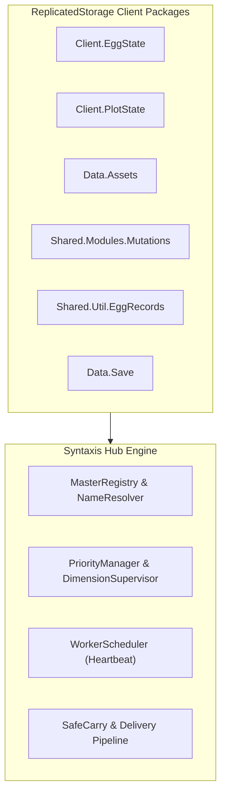
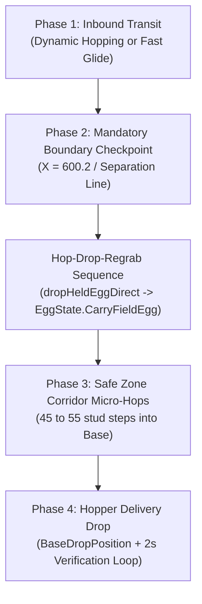
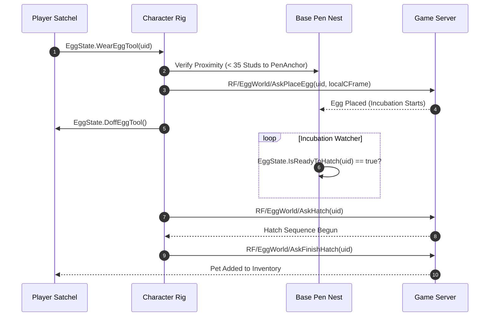

| `c1385bcaf832eb45d76607710158e38098e8c4d6` | `feat(halloween): pumpkin 1000-stud altar priority, eliminate test HUD, separate town dimension` | Overhauled Auto Pumpkin with 1,000-stud scan range and strict Altar-proximity sorting. Completely eliminated temporary draggable PhantomExpressHUD and status overlays in favor of in-memory status tracking. Implemented independent Town dimension detection (`isInForgottenTown`, `isAboardPhantomExpress`, `isInTrainEvent`) preventing incorrect portal entry while on train or in Town. Preserved Normal Dimension Auto Steal 100% byte-for-byte intact. |
# SYNTAXIS HUB (`qualcom`) - PROJECT KNOWLEDGE BASE

> **Notice:** This document is the living knowledge repository for the Syntaxis Hub project. It contains all architectural decisions, reverse-engineered game mechanics, remote endpoints, algorithm designs, executor compatibility rules, priority systems, and known issues. **Every time new knowledge is discovered, implemented, or refactored, this document must be updated.**

---

## Table of Contents
1. [Project Overview & Multi-Repository Architecture](#1-project-overview--multi-repository-architecture)
2. [Platform & Universal Executor Compatibility Layer (`UniversalCompat`)](#2-platform--universal-executor-compatibility-layer-universalcompat)
3. [Client Engine Hooking & Game Module Architecture](#3-client-engine-hooking--game-module-architecture)
4. [Complete Network Remotes Catalog (93 Total)](#4-complete-network-remotes-catalog-93-total)
5. [Valuation Formulas, Scoring & Rarity Tiers](#5-valuation-formulas-scoring--rarity-tiers)
6. [Automation Engines & Core Subsystems](#6-automation-engines--core-subsystems)
   - 6.1 [Stealing & Delivery Engine](#61-stealing--delivery-engine)
   - 6.2 [Egg Placement & Incubation-Aware Hatching](#62-egg-placement--incubation-aware-hatching)
   - 6.3 [Pet Management, Satchel & Fusion Chamber](#63-pet-management-satchel--fusion-chamber)
   - 6.4 [Treadmill & Homestead Upgrades](#64-treadmill--homestead-upgrades)
   - 6.5 [Halloween Dimension & World Automations](#65-halloween-dimension--world-automations)
     - 6.5.1 [Halloween Dimension Rules & Autonomous Travel](#651-architectural-rules-halloween-event-2026--halloween-dimension)
   - 6.6 [Character Integrity, GodMode & Anti-Ragdoll](#66-character-integrity-godmode--anti-ragdoll)
   - 6.7 [Travel, Movement & Tweening Architecture Rules](#67-travel-movement--tweening-architecture-rules)
7. [Unified Priority System & Concurrency Architecture](#7-unified-priority-system--concurrency-architecture)
8. [Anti-Cheat Detection Vectors & Hardening Guidelines](#8-anti-cheat-detection-vectors--hardening-guidelines)
9. [Commit History & Version Milestones](#9-commit-history--version-milestones)

---

## 1. Project Overview & Multi-Repository Architecture

### 1.1 Repositories & Distribution
- **Main Automation Script:** [`tenobarillas-ship-it/sae`](https://github.com/tenobarillas-ship-it/sae)
  - Primary script entry: `qualcom` (Luau script executed via standard Roblox `loadstring`).
  - Living knowledge base: `KNOWLEDGE.md`.
  - Engineering feedback & operating guidelines: `feedback.md`.
  - Standalone loader:
    ```lua
    loadstring(game:HttpGet("https://raw.githubusercontent.com/tenobarillas-ship-it/sae/main/qualcom"))()
    ```
- **Modular GUI Library:** [`tenobarillas-ship-it/GUILib`](https://github.com/tenobarillas-ship-it/GUILib)
  - Liquid Glass iOS-inspired UI library cleanly separated from automation logic.
  - Modular distribution: `src/` (`Window`, `Components`, `Panels`, `Themes`, `Animations`, `Utils`, `Modals`).
  - Bundled single-request loader: `SyntaxisLib.lua`.
    ```lua
    local SyntaxisLib = loadstring(game:HttpGet("https://raw.githubusercontent.com/tenobarillas-ship-it/GUILib/main/SyntaxisLib.lua"))()
    ```
- **Reference Repository (Private):** [`tenobarillas-ship-it/cool`](https://github.com/tenobarillas-ship-it/cool)
  - Houses the monolithic 49,217-line reference script `hot.lua`.
  - Used strictly for reverse engineering, remote discovery, and algorithm comparison.

### 1.2 Local Workspace & Settings Persistence
- **Local Working File:** `qualcom_clean.lua` (4,479 lines / 171 KB).
- **Settings Files (on executor):**
  - `SyntaxHubSettings.json` / `SyntaxHub_Config.json`: Persists UI states, toggles, filter dropdowns, and custom priority rankings via `readfile` / `writefile`.
  - `ChilliLibrary/SAE_Priority.json` (Reference implementation format).

---

## 2. Platform & Universal Executor Compatibility Layer (`UniversalCompat`)

### 2.1 Platform Breakdown: Mobile vs PC Executors
- **Delta Mobile (Android):** Employs full C-level closures for `fireproximityprompt(prompt, 0)` and `firetouchinterest(part1, part2, 0/1)`. Operates in a unified 32/64-bit ARM environment.
- **PC Executors (Wave, Synapse Z, Macsploit, Solara, Celery):**
  - **Proximity Prompts:** Often lack `fireproximityprompt` completely (`nil`), or accept only specific argument counts (`prompt, 0`), or throw exceptions if called without `pcall`. Direct engine calls (`prompt:InputHoldBegin()`) fail unless `RequiresLineOfSight` is disabled, distance checks pass, and hold durations are allowed at least 1-2 frames.
  - **Touch Interests:** Many budget PC executors have stubbed `firetouchinterest` implementations that do not replicate `Touched` events across distances. If a character hovers above a target (e.g. 14 studs), `firetouchinterest` does not hit unless the weapon handle physically intersects the target's bounding box.
  - **Button Clicks:** `getconnections` is frequently stubbed or lacks `:Fire()`. Official Roblox `VirtualInputManager` is required as a reliable engine fallback.

### 2.2 Universal Compatibility & Polyfill Layer (`UniversalCompat`)
All script automation modules route through `UniversalCompat` rather than making raw executor calls. It is engineered to be **100% Touch & Mobile-Safe** with zero synthetic input flags:

1. **`UniversalCompat.FireProximityPrompt(prompt)`**:
   - Matches the cool reference implementation (`hot.lua` line 30064):
     ```lua
     local function FirePrompt(prompt)
         if prompt and type(fireproximityprompt) == "function" then
             pcall(function()
                 prompt.HoldDuration = 0
                 fireproximityprompt(prompt)
             end)
         end
     end
     ```
   - **Zero Property Tampering:** Never modifies `MaxActivationDistance` or `RequiresLineOfSight` on server-replicated prompts (which causes client/server property desync and triggers anti-tamper kicks).
   - **Zero VirtualInputManager:** Completely eliminates `VirtualInputManager:SendKeyEvent` simulation, avoiding synthetic keyboard event injection on touchscreen devices (Delta Android/iOS).
   - **Legitimate Physical Positioning:** The player character is positioned within interaction reach ($le 4$ studs) before firing, ensuring prompts trigger naturally within server distance boundaries.

2. **`UniversalCompat.FireTouch(part1, part2)`**:
   - **Method A:** Dual-stage `firetouchinterest(part1, part2, 0)` $
ightarrow$ `task.wait(0.01)` $
ightarrow$ `(part1, part2, 1)`.
   - **Method B:** Fallback ensures `CanTouch = true` on participating BaseParts.
   - Works uniformly across PC executors and mobile executors without raising execution exceptions.

3. **`UniversalCompat.ClickButton(btn)`**:
   - Pure event dispatching matching cool source (line 37655):
     1. `firesignal(btn.Activated)` / `firesignal(btn.MouseButton1Click)`
     2. `getconnections(btn.Activated)` loop invoking `c:Fire()` or `c.Function()`
     3. `getconnections(btn.MouseButton1Click)` loop invoking `c:Fire()` or `c.Function()`
   - **Zero MouseButtonEvent:** Avoids `VirtualInputManager:SendMouseButtonEvent` which fails or triggers security flags on pure touch environments where `UserInputService.MouseEnabled == false`.

### 2.3 Safe Container Parenting (`GetSafeParent`)
Roblox executors have varying levels of GUI protection and context permissions:
```lua
local safeContainer = nil
if typeof(gethui) == "function" then
    local ok, res = pcall(gethui)
    if ok and typeof(res) == "Instance" then safeContainer = res end
end
if not safeContainer then
    pcall(function()
        local cg = game:GetService("CoreGui")
        if cg and typeof(cg) == "Instance" then safeContainer = cg end
    end)
end
if not safeContainer then
    safeContainer = LocalPlayer:WaitForChild("PlayerGui")
end
```

### 2.4 Screen-Wide Mouse & Touch Dragging (`MakeDraggable`)
- **Bug Identified:** Using `handle.InputChanged` drops the drag on PC if the user moves the mouse faster than the GUI element's frame update.
- **Rule:** Always attach `UserInputService.InputChanged` and `UserInputService.InputEnded` dynamically when drag starts, and disconnect on drag end.

---

## 3. Client Engine Hooking & Game Module Architecture

Steal an Egg uses internal packages in `ReplicatedStorage` to replicate game state. Intercepting these modules provides direct state access without laggy workspace scanning:



### Key Intercepted Modules:
1. **`ReplicatedStorage.Client.EggState`**:
   - `ReadFieldEggs()`: Returns dictionary of live conveyor eggs (`Uid`, `State`, `AssetCategory`, `AreaId`, `AssetScale`, `Mutations`, `BoundsCFrame`).
   - `ReadOwnerEggs(UserId)`: Returns all eggs owned by the player, including placed pen eggs.
   - `IsReadyToHatch(uid)`: Returns boolean indicating if incubation timer has elapsed.
   - `WearEggTool(uid)` & `DoffEggTool()`: Equips/unequips egg from inventory as a character tool (mandatory before placing!).
   - `CarryFieldEgg(uid)` & `DropFieldEgg(reason)`: Internal carry state hooks.
2. **`ReplicatedStorage.Client.PlotState`**:
   - Manages player homestead plot assignments, pen bounding boxes, and nest slots.
3. **`ReplicatedStorage.Data.Assets`**:
   - Master data table for eggs: base income values, scale multipliers, meshes, species names.
4. **`ReplicatedStorage.Shared.Modules.Mutations`**:
   - Mutation multipliers (e.g. Scrambled, Fractured, Nitro), essence recipes, and drop probabilities.
5. **`ReplicatedStorage.Shared.Util.EggRecords`**:
   - Player discovery Codex / Index records. Used to identify undiscovered breeds.
6. **`ReplicatedStorage.Data.Save`**:
   - Live client save table: currency balance (`Money`, `CandyCorn`, `Souls`), inventory items, and upgrade levels.

---

## 4. Complete Network Remotes Catalog (93 Total)

All client-server communication occurs via `ReplicatedStorage.Packages.Networking`. Below is the complete catalog of **93 Network Remotes** (50 `RemoteFunctions` and 43 `RemoteEvents`):

### 4.1 Stealing & Field Eggs
| Remote Name | Type | Direction | Description & Arguments |
| :--- | :---: | :---: | :--- |
| `RF/EggWorld/AskFieldEggCarry` | RF | Client $\rightarrow$ Server | Grabs field egg into character hands (`uid: string`). |
| `RF/EggWorld/AskFieldEggDrop` | RF | Client $\rightarrow$ Server | Drops carried egg to field floor (`reason: string`). |
| `RF/EggWorld/AskFieldEggSnapshot` | RF | Client $\rightarrow$ Server | Requests full replication snapshot of field eggs. |
| `RE/RigSync/Refresh` | RE | Server $\rightarrow$ Client | Server character position synchronization packet (`Action = "Relocate"` signals rollback). |
| `RE/RigSync/AskRigWipe` | RE | Client $\rightarrow$ Server | Requests character rig clean-up upon physics desync. |

### 4.2 Egg Placement & Incubation Hatching
| Remote Name | Type | Direction | Description & Arguments |
| :--- | :---: | :---: | :--- |
| `RF/EggWorld/AskPlaceEgg` | RF | Client $\rightarrow$ Server | Places equipped egg into base pen nest (`uid: string, localCFrame: CFrame`). |
| `RF/EggWorld/AskHatch` | RF | Client $\rightarrow$ Server | Initiates hatching on ready pen egg (`uid: string`). |
| `RF/EggWorld/AskFinishHatch` | RF | Client $\rightarrow$ Server | Concludes reveal animation and commits pet to inventory (`uid: string`). |

### 4.3 Pet Satchel, Favorites & Selling
| Remote Name | Type | Direction | Description & Arguments |
| :--- | :---: | :---: | :--- |
| `RF/Haul/WearBest` | RF | Client $\rightarrow$ Server | Server evaluates and auto-equips highest multiplier pets. |
| `RE/PetSatchel/SellSelection` | RE | Client $\rightarrow$ Server | Sells list of pets below rarity threshold (`petUids: {string}`). |
| `RE/PetSatchel/WriteFavourite` | RE | Client $\rightarrow$ Server | Toggles favorite flag to protect pet from selling (`petUid: string, state: boolean`). |
| `RF/Fusery/LoadPet` | RF | Client $\rightarrow$ Server | Loads pet into fusion chamber slot (`slot: number, petUid: string`). |
| `RF/Fusery/BeginFuse` | RF | Client $\rightarrow$ Server | Commits pet fusion process. |
| `RF/Fusery/FinishReveal` | RF | Client $\rightarrow$ Server | Claims fused pet reward. |
| `RF/Fusery/EjectPet` | RF | Client $\rightarrow$ Server | Ejects pet from fusion slot if recipe incomplete (`slot: number`). |

### 4.4 Treadmill & Homestead Upgrades
| Remote Name | Type | Direction | Description & Arguments |
| :--- | :---: | :---: | :--- |
| `RF/Treadmill/AskWearStill` | RF | Client $\rightarrow$ Server | Mounts character onto base treadmill belt. |
| `RF/Treadmill/AskDoff` | RF | Client $\rightarrow$ Server | Dismounts character from treadmill belt. |
| `RF/Treadmill/AskTierRaise` | RF | Client $\rightarrow$ Server | Upgrades treadmill tier (`tierId: string`). |
| `RE/Homestead/AskBaseTierRaise` | RE | Client $\rightarrow$ Server | Upgrades homestead base expansion plot. |

### 4.5 Live Events & World Systems
| Remote Name | Type | Direction | Description & Arguments |
| :--- | :---: | :---: | :--- |
| `RE/ShootingStar/Catch` | RE | Client $\rightarrow$ Server | Collects landed shooting star item (`starModel: Model`). |
| `RE/ShootingStar/Hold` | RE | Client $\rightarrow$ Server | Toggles shooting star carry state (`state: boolean`). |
| `RF/Butterflies/AskClaimNet` | RF | Client $\rightarrow$ Server | Claims butterfly net item. |
| `RF/Butterflies/Equip` | RF | Client $\rightarrow$ Server | Equips butterfly net tool. |
| `RF/Butterflies/AskTradeUp` | RF | Client $\rightarrow$ Server | Trades 5 lower-tier butterflies for 1 higher-tier butterfly. |
| `RF/Butterflies/AskCraftEssence` | RF | Client $\rightarrow$ Server | Crafts Enchanted Essence at the Mutation Shrine. |
| `RF/WispCompanion/Request` | RF | Client $\rightarrow$ Server | Submits eggs / fulfills wisp companion quests. |

### 4.6 Halloween Dimension & Seasonal Systems
| Remote Name | Type | Direction | Description & Arguments |
| :--- | :---: | :---: | :--- |
| `RF/HalloweenDimension/AskCarryEgg`| RF | Client $\rightarrow$ Server | Grabs event egg in Halloween Dimension. |
| `RF/HalloweenDimension/AskDropEgg` | RF | Client $\rightarrow$ Server | Drops event egg in Halloween Dimension. |
| `RF/HalloweenDimension/AskBuyEgg` | RF | Client $\rightarrow$ Server | Purchases Halloween egg using Candy Corn currency. |
| `RE/HalloweenDimension/MonsterHit` | RE | Client $\rightarrow$ Server | Registers weapon damage against Halloween monster (`monster: Model, weaponId: string`). |
| `RE/GhostBoss/Suction` | RE | Client $\rightarrow$ Server | Applies vacuum stream damage to Ghouler boss. |
| `RF/BossEvent/AskEnter` | RF | Client $\rightarrow$ Server | Requests entry into the Pumpkin King arena through `HalloweenDimension.BossPortal` (used by Auto Boss). |
| `RE/PumpkinBoss/CannonFire` | RE | Client $\rightarrow$ Server | Fires the player's assigned arena cannon at the Pumpkin King (Auto Boss sends `()`, `(cannon)`, `(CannonId)` payloads). |
| `RF/GhostDogQuest/Talk` | RF | Client $\rightarrow$ Server | Advances Ghost Dog NPC quest dialog. |
| `RF/GhostDogQuest/Cast` | RF | Client $\rightarrow$ Server | Casts fishing rod during Ghost Dog quest. |
| `RF/GhostDogQuest/Dive` | RF | Client $\rightarrow$ Server | Dives underwater for quest items. |
| `RF/GhostDogQuest/Surface` | RF | Client $\rightarrow$ Server | Surfaces after underwater dive. |
| `RF/GhostDogQuest/Claim` | RF | Client $\rightarrow$ Server | Claims Ghost Dog quest completion reward. |
| `RF/Fishing/Cast` | RF | Client $\rightarrow$ Server | Casts fishing line with luck parameter (`luckMultiplier: number`). |
| `RF/Fishing/Reel` | RF | Client $\rightarrow$ Server | Reels in caught fish. |
| `RF/TrainEvent/Action` | RF | Client $\rightarrow$ Server | Boards or exits Phantom Express ghost train (`action: "Board" | "Exit"`). |
| `RF/ScrambleTradeIn/AskTradeIn` | RF | Client $\rightarrow$ Server | Commits pets to Dr. Scramble mutation trade-in. |

---

## 5. Valuation Formulas, Scoring & Rarity Tiers

### 5.1 Egg Score Calculation Formula
$$\text{Score} = (\text{Rank} \times 1000) + (\text{Scale}^{1.85} \times \text{MutationBonus})$$
- `MutationBonus`: $2.5$ if mutated, $1.0$ otherwise.
- **Scale Factor Formulation:**
  - If $\text{Scale} > 5.0$:
    $$\text{Factor} = \left(\frac{\text{Scale}}{5}\right)^{1.2} \times 19.637875755794113$$
  - Else:
    $$\text{Factor} = \text{Scale}^{1.85}$$

### 5.2 Rarity Ranks Table
| Rank | Tier Name | Base Multiplier | Color Tag |
| :---: | :--- | :---: | :--- |
| **1** | Common | $1.0\times$ | Gray |
| **2** | Uncommon | $1.5\times$ | Green |
| **3** | Rare | $2.5\times$ | Blue |
| **4** | Epic | $4.0\times$ | Purple |
| **5** | Legendary | $7.5\times$ | Gold / Yellow |
| **6** | Mythic | $15.0\times$ | Red |
| **7** | Cosmic | $30.0\times$ | Cyan |
| **8** | Secret | $75.0\times$ | White / Sparkle |
| **9** | Eternal | $150.0\times$ | Orange Fire |
| **10** | Divine | $350.0\times$ | Rainbow |

---

## 6. Automation Engines & Core Subsystems

### 6.1 Stealing & Delivery Engine

#### Normal Dimension Target Areas:
Forest, Lake, Desert, Jungle, Snow, Volcano, Abyss Ocean, Prehistoric, Cosmic, Cherry Blossom, Titan Temple, Light Dark, Enchanted Forest.

#### The Anti-Cheat Distance Rollback Vector:
> [!IMPORTANT]
> The Steal an Egg server anti-cheat monitors cumulative distance traveled while continuously holding an egg. If a character traverses over $\sim 400$ studs continuously without dropping, the server flags displacement and fires `RE/RigSync/Refresh` with `Action = "Relocate"` (rubber-band rollback) or forces an unprompted drop.

#### Restored 4-Phase Delivery Sequence (`qualcom`):
In commit `bc4ca86`, an experimental delivery method attempted to anchor the character to the base treadmill (`AskWearStill`) and teleported directly from the boundary ($X \approx 600$) to the hopper ($X \approx 150$) in a single 450-stud jump. This triggered severe physics desync, anti-cheat drop penalties, and delivery failures. The restored 4-Phase Delivery Sequence eliminates all unprompted teleports and treadmill anchoring:



1. **Phase 1: Inbound Route (Dynamic Hopping or Fast Glide):**
   - **Dynamic Hopping Mode (`executeCheckpointedHopsHome`):** Steps along the lane towards the boundary using discrete altitude hops (`groundY = CONFIG.GroundAltitude + 1.0`). Hop step size dynamically scales with player WalkSpeed:
     $$\text{stepSize} = (\text{playerSpeed} < 100) \mathbin{?} \max(34, \text{playerSpeed} \times 0.45) : \min(\text{baseStep}, \max(60, \text{playerSpeed} \times 0.75))$$
     Performs intermediate ground checkpoints (`performGroundCheckpoint`) every `CONFIG.CheckpointInterval` (380 studs) along the lane to keep cumulative held displacement under server limits.
   - **Fast Steal Glide Mode (`executeFastStealDelivery`):** High-speed physics velocity glide along the ground plane towards `CONFIG.SeparationLineX + CONFIG.FastStealLineDropOffset`.
2. **Phase 2: Mandatory Boundary Checkpoint (`performGroundCheckpoint`):**
   - Directly at the boundary line ($X = 600.2$ / Separation Line $X = 545.0$), the character anchors briefly at the safe ground position.
   - **Hop-Drop-Regrab Sequence:**
     - Calls `dropHeldEggDirect()` which notifies both `EggState.DropFieldEgg("PlayerRequest")` and `Remotes.AskFieldEggDrop`.
     - Loops until `isHoldingEgg()` confirms the egg has dropped.
     - **Why this is critical:** Dropping the egg resets the server-side cumulative displacement counter back to zero.
     - Immediately re-grabs via client `EggState.CarryFieldEgg(uid)` (0.12s), with an automatic physical grab fallback (`instantGrabAtPosition`) if the client module is unavailable.
3. **Phase 3: Safe Zone Corridor Micro-Hops:**
   - Traverses the base boundary corridor from $X = 600.2$ down to `CONFIG.BaseDropPosition.X` ($528.7$) using small progressive micro-hops of 45 to 55 studs.
   - **Zero Unprompted Teleports:** Eliminates the single-step 450-stud teleport into base that triggered server drop rollbacks.
4. **Phase 4: Hopper Delivery Drop & Verification:**
   - Positions character at `CONFIG.BaseDropPosition` (altitude $+ 1.2$).
   - Calls `dropHeldEggDirect()`, waits 0.25s, and runs a 2.0-second verification loop to confirm the hopper accepts the egg and `isHoldingEgg()` returns false.

#### Dual-Source Holding Verification (`isHoldingEgg`):
To prevent race conditions where GUI animations lag behind network replication:
- **Client State Machine:** Checks `EggState.Carrying == true` and `EggState.CarryUid ~= nil`.
- **ScreenGui Detection:** Checks `PlayerGui.DropHeldEgg.Enabled` and `PlayerGui.RunBackEffects.Enabled`.
- **Seasonal Dimension Fallback:** Scans for active `Drop` buttons in `PlayerGui` while inside the Halloween dimension.

---

### 6.2 Egg Placement & Incubation-Aware Hatching

> [!CAUTION]
> **Why Previous Hatching Implementations Failed:**
> Steal an Egg **does not support hatching directly from the inventory satchel**. Eggs must undergo an incubation lifecycle on base plot pens before the server allows hatching.



1. **Auto Place Egg (`SetupAutoPlaceEgg`):**
   - Scans backpack for eligible unhatched eggs matching configured rarity/value filters.
   - Verifies character is within 35 studs of the base pen anchor (`PenAnchor`).
   - Equips egg as tool: `EggState.WearEggTool(uid)`.
   - Invokes `RF/EggWorld/AskPlaceEgg` with UID and slot CFrame.
   - Cleans up tool state: `EggState.DoffEggTool()`.
2. **Auto Hatch (`SetupAutoHatchModule`):**
   - Queries placed eggs belonging to the player: `EggState.ReadOwnerEggs(UserId)`.
   - Filters for eggs currently placed in a pen nest (`Placement ~= nil`).
   - Tests incubation status: `EggState.IsReadyToHatch(uid) == true`.
   - Invokes `RF/EggWorld/AskHatch` followed by `RF/EggWorld/AskFinishHatch`.

---

### 6.3 Pet Management, Satchel & Fusion Chamber
- **Auto Equip Best (`RF/Haul/WearBest`):**
  - Invokes server remote to recalculate and equip top income multiplier pets automatically.
- **Auto Sell Pets (`RE/PetSatchel/SellSelection`):**
  - Iterates satchel pets below configured rarity ceiling.
  - **Strict Safety Guards:**
    - Checks `KeepMutatedPets`: Never sells pets with mutation flags.
    - Checks `BlacklistSellPetsMap`: Never sells blacklisted species.
- **Auto Favorite (`RE/PetSatchel/WriteFavourite`):**
  - Automatically flags equipped and high-tier pets as favorites to prevent liquidation.
- **Auto Fusion Chamber (`RF/Fusery/...`):**
  - Loads eligible duplicate pets into chamber slots via `LoadPet`.
  - Fires `BeginFuse`, waits for incubation reveal, and claims via `FinishReveal`.
  - If incomplete duplicates exist, invokes `EjectPet` to return pets to the satchel.

---

### 6.4 Treadmill & Homestead Upgrades
- **Treadmill Training (`RF/Treadmill/AskWearStill` & `AskDoff`):**
  - Serves as the idle speed training fallback when no higher-priority tasks have work.
  - Verifies character attachment to belt; auto-recovers if knocked off.
  - Yields immediately (`hopOffTreadmill()`) as soon as any higher-priority task claims the character.
- **Auto Upgrades (`tryUpgradeTreadmill` & `tryUpgradeBase`):**
  - Passive background tasks running every 5–6 seconds.
  - Checks player currency against `Treadmills.GetByUpgradeLevel(lvl + 1).Price`.
  - Invokes `RF/Treadmill/AskTierRaise` and `RE/Homestead/AskBaseTierRaise` without moving character or interrupting stealing.

---

### 6.5 Halloween Dimension & World Automations

- **Heartbeat Linear Glide Portal Transportation (`EnterDimension` & `ExitDimension`):**
  - Replaces ordinary `TweenService` with a physics-safe Heartbeat linear glide at 240 studs/s directly to `HalloweenDimensionPortal.Hitbox` (and exit portal).
  - Synchronizes `AssemblyLinearVelocity` with direction and speed on every frame, eliminating desynchronization and server-side speed/distance rollback flags.
  - Maintains critical bypass interceptions during transit: `setCollisions(false)`, `hum.PlatformStand = true`, and `hum.AutoRotate = false`.
  - Monitors dimension arrival every frame: breaks transit early if player enters dimension mid-flight, character dies, or task is aborted.
  - Upon arrival at the hitbox, pins velocity (`Vector3.new(0, -0.5, 0)`), triggers touch interests via `UniversalCompat.FireTouch`, restores humanoid physics states, and verifies dimension replication.
- **Auto Pumpkin Moon Event Gating & Loop Resolution:**
  - **The Defect Fixed:** Previously, outside the Halloween dimension, `PriorityManager:HasWork("Auto Pumpkin")` unconditionally returned `true`, causing the Dimension Supervisor to loop entering and exiting the portal indefinitely.
  - **Authoritative Gating:** `HalloweenPumpkinManager:IsEventActive()` strictly verifies global world attributes: `workspace:GetAttribute("HalloweenWorldEvent") == "PumpkinMoon"` or `workspace:GetAttribute("WorldEvent") == "PumpkinMoon"`.
  - When the event is inactive and player is not carrying a pumpkin, `HasWork` immediately returns `false`. The character remains completely idle outside the portal.
- **Auto Ghost Dog Quest (`GhostDogManager`):**
  - Automates the full 5-stage seasonal questline in the Halloween Dimension, terminating in unlocking the exclusive **Phantom Express Conductor Ticket**.
  - **Marker Discovery:** Discovers named BaseParts under `HalloweenDimension.GhostDogQuest.Markers` (`DogSpot`, `FishermanSpot`, `Artifact_Collar`, `Artifact_Bone`, `Artifact_Toy`, `Artifact_Photo`, `CastSpot`, `CastTarget`, `ReturnSpot`).
  - **Dialogue State Machine:** Talks to NPCs via `RF/GhostDogQuest/Talk` (`"Dog"`, `"Fisherman"`, `"Rod"`). If response indicates `"closer"`, micro-steps 3 studs and retries up to 3 times.
  - **Artifact Collection:** Queries quest artifacts table. Seamlessly visits missing items, fires `RF/GhostDogQuest/Collect(artifactName)`, and returns to `DogSpot` to advance stage.
  - **Underwater Spline Chase:** Casts quest rod at `CastTarget`. On bite (`Mode == "Quest"`), cancels fishing, invokes `RF/GhostDogQuest/Cast` to acquire `ChaseId`, invokes `RF/GhostDogQuest/Dive`, sets `Humanoid.PlatformStand = true`, tilts character $-72^\circ$ pitch (`CFrame.Angles(-1.2566, 0, 0)`), and glides along the `Data.GhostDogQuest.ChaseFrame` spline at 58 studs/s.
  - **Claim & Surface:** Executes up to 8 claim attempts via `RF/GhostDogQuest/Claim`, calls `RF/GhostDogQuest/Surface` to return to ground level at `ReturnSpot`, restores `PlatformStand = false`, and unlocks `ConductorTicket`.
- **Auto Dock Fishing Engine (`HalloweenFishingManager`):**
  - **Water Surface Raycasting (Multi-Pass Transparency Penetration):** Loops up to 6 iterations downward 180 studs. Any transparent barrier or atmospheric trigger zone (`inst.Transparency >= 0.95`) is dynamically appended to `FilterDescendantsInstances`, penetrating through to the underlying water surface. Validates water contact via `hit.Material == Enum.Material.Water`, `TerrainRole == "Basin"`, `hit:GetAttribute("FishingWater")`, or tag `FishingWater`.
  - **Accurate Radial Direction Scanner:** Centers angles on the lake's true heading using the `LookVector` of `workspace.GhostFisherman` or `ReturnSpot` (`baseAngle = math.atan2(lookVec.Z, lookVec.X)`). Scans 13 radial angles at dynamic distance $10 + 32 \times \text{Charge}$ ($\approx 38$ studs at 0.875 charge) while guaranteeing $\ge 12$ studs separation from the quest ripple (`CastTarget`).
  - **Character Orientation & Velocity Pinning:** Directly orients character CFrame towards target water point (`CFrame.lookAt`) and suppresses linear/angular velocity during cast and bite wait.
  - **Ghost Dog Quest Stage 3 Interception:** Detects if the player is currently on Stage 3 of the Ghost Dog Quest. Because standard fishing is locked by the server until the quest fish is caught, Auto Fishing automatically delegates to `GhostDogManager:Process()` to perform the ripple cast, underwater spline dive, and ticket claim.
  - **Tension Hold & Reel Simulation:** Computes hold duration: $\text{holdDuration} = 1.2 \times \text{Charge}^{0.7142857}$. Fires `RE/Fishing/Hold`, waits duration, and invokes `RF/Fishing/Cast`. Simulates reel clicks via client `FishingController.Ui.PunchReel` over the 1.2s bite window, then invokes `RF/Fishing/Reel(biteId, "Caught", 16)`. Automatically diverts ghost fish bites to underwater spline chase.
- **Auto Buy Halloween Dimension Egg:**
  - Automated merchant purchasing in the Halloween Dimension via `RF/HalloweenDimension/AskBuyEgg` with rate-limiting debounce.
- **Auto Steal Halloween Eggs (`HalloweenStealManager`):**
  - **Dedicated UI Controls:** `"Auto Steal Halloween Eggs"` toggle with instant abort (`HalloweenStealManager.Abort()`), `"Target Areas"` multi-dropdown (`All`, `Graveyard`, `Haunted Swamps`, `Abandoned Manor`), and `"Min Rarity"` dropdown (`All` through `10 - Divine`).
  - **Area & Rarity Filtering:** Employs the reference script's exact area detection boundaries ($\\le 550$ studs = Graveyard, $\\ge 1200$ studs = Abandoned Manor, between = Haunted Swamps; Zone attributes 1/2/3; keywords) alongside `HalloweenAreaManager:GetArea(egg)` and `DynamicRarityResolver:MeetsMinRarity(egg, minFilter)`. Prioritizes the rarest/highest-value egg with distance tie-breaker.
  - **Action-Gated Dimension Portal Integration:** When enabled while in the normal dimension, ONLY enters `HalloweenDimension` if an action is actually required (`isCarryingEgg() or selectTargetEgg() ~= nil`) and the map is open. If no candidate egg exists in your selected area/rarity, the bot remains in the normal dimension without entering the portal.
  - **Dual-Workflow Architecture (Direct Reference Integration):**
    - *Graveyard Eggs:* Discrete 40-stud `stepMove` to nest $\\rightarrow$ grab via prompt & `AskCarryEgg` $\\rightarrow$ `stepMove` to SafeZone boundary (+10 studs) $\\rightarrow$ zero velocity & wait 1.5s (`GraveyardDeliverDelay`) $\\rightarrow$ `naturalWalkTo` inside SafeZone (-10 studs) at natural WalkSpeed.
    - *Haunted Swamps & Abandoned Manor Eggs:* `stepMove` to nest $\\rightarrow$ grab $\\rightarrow$ `stepMove` to boundary $\\rightarrow$ drop via `AskDropEgg` $\\rightarrow$ scan 130-stud radius around gate for dropped egg $\\rightarrow$ `stepMove` onto dropped egg coordinates $\\rightarrow$ regrab via prompt & remote $\\rightarrow$ settle 0.4s (`OriginSettleTime`) $\\rightarrow$ `naturalWalkTo` inside SafeZone.
- **Candy Cane Monster Farm (`HalloweenCombatManager`):**
  - Rapid multi-bat auto-switching melee combat targeting seasonal monsters at safe hover elevation.
- **Auto Boss (Pumpkin King) — 6-State Autonomous Recurring Event State Machine (`HalloweenBossManager`):**
  - **Cross-Dimension Gateway Check:** Checks `HalloweenPortalManager.IsInHalloweenDimension()` before attempting to reach `BossPortal`; if in the normal world, glides through `HalloweenDimensionPortal` first rather than flying across the void.
  - **Persistent State Table:** `getgenv().BossAutomationState = { CurrentState, KingEncountered, CurrentBatIndex, StateEnteredAt, IsBusy }` (mirrored to `BossFarmerState`).
  - **Explicit 6-State Lifecycle:**
    1. **`WAITING`:** In overworld. Monitors entrance portal seal (`HalloweenDimension.BossPortal.BossPortalSeal`). If closed/locked, returns `HasWork() == false` to allow lower-priority tasks (Auto Steal, Auto Fishing) to run. When all seal meshes turn transparent (`isBossPortalOpen() == true`), transitions to `ENTERING`.
    2. **`ENTERING`:** Glides to portal hitbox (`GlideSpeed = 250`), calls `RF/BossEvent/AskEnter`, and confirms arena arrival (`isPlayerInArena()` or $\le 600$ studs from center) $\rightarrow$ transitions to `INITIALIZING`.
    3. **`INITIALIZING`:** Replication safety buffer (`CONFIG.InitBufferTime = 3.0`). Waits inside the arena for the boss model or arena phase to replicate before taking any combat action, eliminating premature exits or misfires.
    4. **`ACTIVE`:** Handles combat phases:
       - *Phase 1 (Brute):* Melee combat at 14-stud rear standoff (`FloorY + 3`), cycling bats every 0.05s and firing `RE/HalloweenDimension/MonsterHit`.
       - *Cannon Phase:* When King has an active shield (`Phase == "Shield"`) or is stunned (`Phase == "Stunned"`), locates assigned cannon (`OwnerUserId == LocalPlayer.UserId` or `TutorialBeam`), destroys obstructing vines with bat strikes, raycasts down to green stand pad, and fires `RE/PumpkinBoss/CannonFire` with rate-limited debounce (0.18s).
       - *King Melee Phase:* Unshielded King combat at 14-stud rear offset.
    5. **`EXITING`:** Protected defeat detection (`isEntireEventCompleted`) requires `state.KingEncountered == true` (preventing Phase 1 Brute death from triggering early exit) alongside `Health <= 0`, phase in `{Defeated, Finished, Victory, Ended}`, or dead King humanoid. Immediately glides to `BossExitPortal.Hitbox` and steps outside $\rightarrow$ transitions to `COOLDOWN`.
    6. **`COOLDOWN`:** While outside the arena, ignores the lingering open portal. Yields character ownership (`HasWork() == false`) so other tasks can execute. Confirms `elapsed >= 10.0s` and verifies all seal parts have locked (`desc.Transparency < 0.5`) via `isBossPortalLocked()` $\rightarrow$ transitions to `WAITING` to rearm for the next event.

- **Universal Map Closed Rule & Auto Buy Exception:**
  - All Halloween event features (`Candy Cane Farm`, `Auto Pumpkin`, `Halloween Boss`, `Ghost Dog`, `Halloween Fishing`, `Halloween Steal`) observe the universal map gate `isHalloweenMapClosed()`. When closed, they pause and wait; once open, they proceed with actions.
  - **Exception:** `Auto Buy Halloween Egg` is explicitly exempt from `isHalloweenMapClosed()` and operates continuously.
### 6.5.1 Architectural Rules: Halloween Event 2026 = Halloween Dimension

> [!IMPORTANT]
> **Core Architectural Principle:**
> **Halloween Event 2026 = Halloween Dimension.**
> Any feature categorized under **Halloween Event 2026** is fundamentally associated with the Halloween Dimension. Whenever a new feature is added under this category, it must recognize and operate within the Halloween Dimension.

#### 1. Automatic Halloween Dimension Entry
- **Prerequisite Check:** Before executing any action belonging to the **Halloween Event 2026** category, the system must check whether the player is currently inside the Halloween Dimension.
- **Normal Execution:** If the player is already inside, execute the feature normally.
- **Controlled Entry:** If the player is NOT inside, ensure the player enters the Halloween Dimension through the appropriate portal before executing the feature.
- **Execution Guard:** Do NOT execute Halloween-specific actions while the player is still outside the required dimension.
- **Future-Proofing:** This rule must apply universally to any new Halloween Event 2026 features added in the future.

#### 2. Non-Interference With Autonomous Navigation Features (Important Exception)
This is an essential architectural boundary. Some features possess their own dedicated navigation logic and require traveling between different dimensions, portals, arenas, or locations to complete their tasks:
- **Example — Auto Boss:** When enabled, Auto Boss independently handles everything required for its operation (locating and entering portals, traveling to the boss arena, fighting the boss, and safely exiting the arena).
- **Strict Boundary:** The Halloween Dimension entry system must **NOT** interrupt, override, redirect, or conflict with these actions.
- **Scope Restriction:** The responsibility of the Halloween Dimension entry system is **ONLY** to ensure that the player enters the Halloween Dimension when a Halloween-specific action requires it and the player is currently outside that dimension. It must **NOT** take control of navigation that already belongs to another feature.

#### 3. Feature Ownership, Navigation Isolation & Priority
- **Decentralized Ownership:** Each feature remains strictly responsible for its own navigation and action sequences.
- **Prerequisite Check vs Global Controller:** The Halloween Dimension entry rule is a prerequisite pre-flight check, **not** a global navigation controller.
- **No Reverse Forcing:** Do not force the player back into the Halloween Dimension while another feature is legitimately traveling to another dimension, arena, or location.
- **No Portal Spam:** Do not repeatedly trigger portal entry while another feature is actively executing its own navigation.
- **Zero Collision:** Eliminate conflicting movement, portal interactions, teleportation, or other navigation actions between concurrent features.

> [!TIP]
> **Core Principle:**
> Halloween-specific features must ensure the player is in the Halloween Dimension before performing their actions. However, features with their own navigation requirements must retain full, unhindered control of their travel and execution logic.
> This rule is a permanent architectural guideline for all current and future feature implementations.

### 6.6 Character Integrity, GodMode & Anti-Ragdoll
To prevent death loops, ragdoll exhaustion, and speed resets:
```lua
local function applyGodMode(character)
    if not character then return end
    local humanoid = character:FindFirstChildOfClass("Humanoid")
    if not humanoid then return end

    local blockedStates = {
        Enum.HumanoidStateType.FallingDown,
        Enum.HumanoidStateType.Ragdoll,
        Enum.HumanoidStateType.Physics
    }
    for _, state in ipairs(blockedStates) do
        pcall(function() humanoid:SetStateEnabled(state, false) end)
    end
    pcall(function() humanoid.BreakJointsOnDeath = false end)

    for _, desc in ipairs(character:GetDescendants()) do
        if desc:IsA("BallSocketConstraint") or desc:IsA("HingeConstraint") or 
          (desc:IsA("NoCollisionConstraint") and string.find(desc.Name, "Ragdoll", 1, true)) then
            pcall(function() desc:Destroy() end)
        elseif desc:IsA("Motor6D") and not desc.Enabled then
            desc.Enabled = true
        end
    end
end
```

### 6.7 Travel, Movement & Tweening Architecture Rules

To guarantee cross-executor stability, physics synchronization, and immunity to anti-cheat distance/speed rollback flags, all character movement and navigation across the script must adhere to the following architecture rules:

#### 1. Tweening and Movement Constraints
- **Do Not Use Ordinary `TweenService` for Character Travel:** Roblox's ordinary `TweenService:Create` moves a character's RootPart without updating `AssemblyLinearVelocity` or accounting for physics state transitions (`PlatformStand`, ragdoll hooks), triggering server-side teleport or speed rollback detections.
- **Inspect Existing Movement Architecture First:** Before implementing any character movement, inspect the existing movement system and understand how its interception handling, movement hooks (`PlatformStand`, `setCollisions(false)`), and compatibility mechanisms (`UniversalCompat`) work.
- **Reuse Established Movement Implementations:** Always reuse the established Heartbeat linear glide pattern (`GlideTo`: linear `dt` stepping + `AssemblyLinearVelocity` synchronization + collision suppression) rather than creating a separate, simplified or divergent movement system.
- **Preserve Compatibility Mechanisms:** Movement speed can be adjusted when necessary, but changes must preserve the existing movement architecture and its compatibility mechanisms.
- **Never Bypass Movement Handling for Raw Speed:** Do not remove or bypass existing movement handling just to make movement faster.
- **Avoid Unnecessary Delays:** Avoid introducing arbitrary waits or slow movement behavior (e.g. 55 studs/s crawls).

#### 2. Travel Speed Optimization Rules
- **Speed Review Scope:** Features involving character travel (Auto Fish dock navigation, Auto Pumpkin pursuit, Ghost Dog quest markers, Phantom Express boarding, Ghouler Boss vacuum/souls) may have their movement speed reviewed and optimized (standardized at 180–280 studs/s).
- **Separation from Teleportation (TP):** Teleportation (TP) behavior must remain strictly separate and must NOT be modified as part of ordinary travel-speed optimization.
- **Feature-Specific Requirements:** Always check whether a feature has its own movement requirements (e.g. proximity prompt activation ranges, water detection, moving NPC lead tracking) before changing its speed.

#### 3. Strict Boundary: Normal Dimension Auto Steal Exclusion
- **Normal Dimension Auto Steal (`FastSteal` / `AutoFarm`, lines 4800–5500 & 5809–5920):** Is **100% EXCLUDED** from general travel-speed optimization or refactoring.
- Its exact 4-phase delivery pipeline, hop-drop-regrab boundary checkpoint ($X = 600.2$), micro-hop corridor steps, and natural `hum.WalkSpeed` carry must remain completely untouched.

---

---

## 7. Unified Priority System & Concurrency Architecture

### 7.1 Authoritative Character Ownership Mutex (`ActiveTask`)
To resolve concurrent task execution conflicts (where two active features fight over the character's velocity and CFrame), the system enforces a **Centralized Character Ownership Lock**:
1. **Ownership Lock (`ActiveTask` & `ActiveTaskExpiresAt`):**
   - When a task begins a multi-second physical action (e.g. `Auto Steal` carrying an egg, `HalloweenPumpkin` carrying a pumpkin, `Candy Cane Farm` attacking a monster, `Ghost Dog` diving underwater), it calls `PriorityManager:Acquire(taskName, maxDuration)`.
   - While the lock is held, `PriorityManager:IsLocked()` returns `true`.
   - Other tasks calling `PriorityManager:CanRun(otherTask)` immediately return `false`.
   - When the action concludes or fails, the owning task calls `PriorityManager:Release(taskName)`, clearing the lock.
   - A safety timeout (default 15–35s) ensures the lock automatically expires if an unexpected script exception occurs, preventing deadlocks.
2. **Elimination of Destructive Mid-Flight Preemptive Aborts:**
   - Previously, background worker loops called `Abort()` on active managers whenever `CanRun()` returned `false`. This caused tasks to clobber and cancel each other mid-flight.
   - In the new architecture, background workers simply yield and wait their turn without calling `Abort()`.
3. **Dimension Supervisor Non-Interference:**
   - The Dimension Supervisor will **NEVER** switch dimensions while `PriorityManager:IsLocked()` is `true`.
   - Dimension transitions only occur when the character is completely idle and free of ownership locks.
4. **Independent Task Decoupling:**
   - Tasks that do not control character movement (such as `Auto Upgrades`) run independently in the background without contending for or locking the character.

### 7.2 Canonical 13-Task Supervisor Hierarchy in `qualcom`
Tasks are evaluated strictly in canonical order (default order, user-reorderable in the Priority UI tab):
1. **`Auto Boss`** (Dimension: `Self` — autonomous portal/arena navigation)
2. **`Auto Ghost Dog`** (Dimension: `Halloween`)
3. **`Auto Train`** (Phantom Express & Train Event, Dimension: `Halloween`)
4. **`Auto Vacuum`** (Auto Vacuum Ghouler Boss, Dimension: `Halloween`)
5. **`Auto Soul Trade In`** (Standalone Soul Shop batch trading, Dimension: `Halloween`)
6. **`Auto Steal`** (Dimension: `Normal`)
7. **`Candy Cane Farm`** (Dimension: `Halloween`)
8. **`Auto Pumpkin`** (Dimension: `Halloween`)
9. **`Auto Fishing`** (Dimension: `Halloween`)
10. **`Auto Buy Halloween Egg`** (Dimension: `Halloween` — exempt from map-closed gating)
11. **`Enchanted / Bloom Event`** (Dimension: `Normal`)
12. **`Auto Upgrades`** (Dimension: `Any` — independent background upgrades)
13. **`Auto Treadmill`** (Dimension: `Normal` — idle training fallback)

> [!NOTE]
> `PriorityManager:Initialize()` inserts tasks missing from a saved `TaskPriorities` list at their **canonical index** (rather than dropping to the bottom), ensuring that new seasonal features naturally slot into their designated ranks upon script startup.

---

## 8. Anti-Cheat Detection Vectors & Hardening Guidelines

1. **Virtual Input Simulation vs Direct Remotes:**
   - **Vector:** Using `VirtualInputManager:SendKeyEvent` or `SendMouseButtonEvent` is monitored by Byfron/Hyperion on 64-bit clients as synthetic input.
   - **Mitigation:** Prioritize direct network remote calls (`RF/`, `RE/`) and internal game modules (`EggState`) over virtual keyboard/mouse clicks.
2. **Carry Displacement Accumulation:**
   - **Vector:** Continuous velocity displacement $> 400$ studs while `isHoldingEgg() == true`.
   - **Mitigation:** Use intermediate `MidDrops = {0.33, 0.66}` with `0.10s` pauses to clear the server accumulator, or use dynamic speed-scaled hops.
3. **Chunk Size & Variable Limits:**
   - **Vector:** Monolithic scripts exceeding $1.5$ MB or containing $> 200$ local variables in a single scope fail to compile on mobile Luau VMs.
   - **Mitigation:** Decouple GUI components into modular libraries (`GUILib`) and scope module state inside isolated closure tables.

---

4. **`CODE BAC-7516` (Bittersweet Anti-Cheat Egg Tool & Placement Flag):**
   - **Trigger Signature:** Triggered when an egg is held or placed on plot, as evidenced in engine logs:
     ```text
     01:00:33 -- EggToolDisplay: [Debug] Attached egg tool display for <Uid>
     01:00:35 -- Server Kick Message: You have been removed for cheating, please remove any cheats to play | CODE BAC-7516; Metadata:
     01:00:35 -- PlacedEggRenderer: [Debug] Rendered placed egg <Uid> for owner <UserId>
     ```
   - **Root Cause:** The server-side anti-cheat (`BAC`) verifies player proximity, physics constraints, and displacement accumulators when attaching the egg tool. If the client manipulates welds or abruptly changes velocity while carrying, BAC flags the session.
   - **Mitigation:** Ensure egg tool weld attachments are not destroyed or unparented manually, and keep character displacement clamped during egg carry.

---

5. **`CODE BAC-10518` (Bittersweet Anti-Cheat Engine Telemetry & State Flag):**
   - **Trigger Signature:** Triggered during combat, proximity interactions, or fast position updates:
     ```text
     02:30:11 -- Server Kick Message: You have been removed for cheating, please remove any cheats to play | CODE BAC-10518; Metadata:
     ```
   - **Root Causes:**
     1. **Synthetic Input (`VirtualInputManager`):** Using `VirtualInputManager:SendKeyEvent` or `VIM:SendMouseButtonEvent` on mobile devices or 64-bit clients sends synthetic desktop input events flagged by engine telemetry.
     2. **ProximityPrompt Property Tampering:** Overwriting `prompt.RequiresLineOfSight = false`, `MaxActivationDistance = 50`, or `HoldDuration = 0` triggers server/client property change listeners.
     3. **Anti-Ragdoll & Constraint Desync:** Forcibly deleting server-instantiated ragdoll constraints (`BallSocketConstraint`, `HingeConstraint`) or force-enabling `Motor6D.Enabled = true` while the server has an active ragdoll state (`RagdollEndTime > workspace:GetServerTimeNow()`).
     4. **Weapon Handle CFrame Teleportation:** Overwriting `handle.CFrame = monsterPart.CFrame` desyncs the tool's `RightGrip` weld from the character's hand.
     5. **Remote Payload Incompatibility:** Calling `RE/PumpkinBoss/CannonFire` simultaneously with 3 mismatched argument types every 0.18s.
   - **Mitigation:**
     1. Completely eliminate `VirtualInputManager`. Rely strictly on native exploit `fireproximityprompt(prompt, 0)` with early exit, or engine `prompt:InputHoldBegin()` without property modification.
     2. Remove recurring `applyGodMode(char)` from the 250ms worker loop. Only configure humanoid state once on character spawn.
     3. Never delete constraints or enable Motor6D while under active server ragdoll (`RagdollEndTime`).
     4. Eliminate tool handle CFrame sweeps in combat; rely exclusively on `firetouchinterest`.
     5. Send single, type-checked remote payloads with safe reload cadence (`>= 0.25s`).

---

## 9. Commit History & Version Milestones

| Commit SHA | Commit Title / Name | Description |
| :--- | :--- | :--- |
| `2f51383cda7eaf2f5ac12c6dc7cbab0245a4c917` | `Initial Clean Baseline` | Clean baseline prior to Halloween dimension integration. |
| `5a3e82b8260bc2602685225a6e79183c455bfb5e` | `fix(halloween): resolve dimension routing conflicts` | Initial dimension routing fixes and portal isolation. |
| `8bd71b0eaaad4a598be3528dc100fd2277caaa05` | `fix: auto upgrades, bloom event, low-speed delivery` | Removed plot proximity check from upgrades; fixed net claim. |
| `bca0e25f55161b1200145862f52d09c883589bf2` | `refactor(gui): integrate modular GUILib` | Decoupled ~2,500 lines of GUI boilerplate into external `GUILib`. |
| `e762c321a1038d6e7e3beb8b6b3185e009277f1e` | `fix(priority): resolve task hierarchy preemption` | Complete priority preemption & bidirectional dimension supervisor. |
| `bc4ca8615c00b895b78cbe33f89ea12dd7b9d10a` | `fix(executor-compat): universal polyfills for PC` | `UniversalCompat` layer for PC executors (prompts, touch, buttons) & safe low-speed delivery. |
| `ca9cbc44f19ece1217971ecd1c302ee307d89fd7` | `revert(qualcom): exact byte-for-byte restore to bc4ca86` | Reverted `qualcom` to stable working baseline commit. |
| `2925295fc800ed6081da4e3b827eb23395436f48` | `docs(knowledge): comprehensive knowledge base restore` | Reverted `KNOWLEDGE.md` to stable baseline before expanded documentation update. |
| `568ba0bca4fe94565c4362142eb1b075bbadb2b5` | `feat(halloween): restore Auto Halloween Egg Steal` | Restored Auto Halloween Egg Steal with 3-phase SafeCarry and eliminated VIM synthetic input detection. |
| `ec93180f8f9c4502a6157fc5375174541182005b` | `revert(qualcom): exact restore to bc4ca86` | Reverted qualcom to stable working baseline commit bc4ca8615c00b895b78cbe33f89ea12dd7b9d10a. |
| `5700ee52bcd652c85a2fe5f4e32d830208f72db3` | `feat(halloween): add Auto Boss (Pumpkin King)` | Added `HalloweenBossManager` (portal-seal detection, arena melee, cannon phase, exit portal), `Auto Boss` toggle, Rank-1 priority task with non-interference lock. |
| `215216a96da8c33db210b6cdef910a1d1b24b4dd` | `fix(anti-cheat): resolve CODE BAC-10518` | Removed `VirtualInputManager`, eliminated ProximityPrompt property mutation, stopped recurring constraint destruction, protected `RagdollEndTime`, and sanitized cannon/combat payloads. |
| `c9ba9da5381ce70cf1842fefd04d67d7219c306a` | `fix(steal): restore 4-phase delivery pipeline` | Restored hop-drop-regrab boundary checkpoint ($X = 600.2$), 45-stud corridor micro-hops, dual holding detection (`EggState` + GUI), and eliminated 450-stud base teleport & treadmill anchoring. |
| `edf23532509cd58510152fad819eb5aba89f312d` | `refactor(boss): event-scoped completion & auto-repeat` | Removed Repeat Boss Runs toggle; scoped completion to current event; King disappearance triggers immediate arena exit; ignores lingering open portal until it closes, automatically re-arming for next event. |
| `3eb79135aa589d6e281ccf3f90960c4862a73eff` | `feat(halloween): complete halloween automation suite & task mutex` | Integrated Auto Ghost Dog Quest (5 stages + spline dive), Auto Fishing (water raycast + charge luck + reel), Phantom Express (ticket boarding + return latch), Auto Vacuum Ghouler Boss (16-point orbit + aim lead + soul shop), TweenService portal entry, PumpkinMoon attribute gating, and Centralized Character Mutex (ActiveTask). |
| `e55a8a4f1e630da82e9c45da2a95f5fab045c708` | `fix(fishing-boss): auto fishing multi-pass raycasting & 6-state auto boss` | Repaired Auto Fishing: radial direction scanner centered on dock LookVector, 6-pass transparency penetration raycast, character orientation & velocity pinning, and Ghost Dog Quest Stage 3 auto-delegation. Integrated 6-state Autonomous Recurring Event State Machine for Auto Boss: WAITING, ENTERING, INITIALIZING (3.0s buffer), ACTIVE, EXITING, COOLDOWN (portal lock verification). |
| `3a1611c3f0c230d5673c3f6020aa3eae4a1da06e` | `feat(nav-pumpkin): auto fish dock navigation, sticky altar pumpkin selection & travel modernization` | Fixed Auto Fish navigation with dedicated dock GlideToSpot (260 studs/s) and sticky spot discovery; overhauled Auto Pumpkin with sticky nearest-target locking within Altar area (<= 280 studs) and dynamic moving pursuit; modernized GhostDogManager:MoveTo with Heartbeat linear glide (180 studs/s, fixing Phantom Express rail boarding and Ghouler vacuum/souls travel); added Section 6.7 Travel & Tweening Architecture Rules; preserved Normal Dimension Auto Steal 100% untouched. |
| `c00059a81a634257d8b1d0cfea29407909d9642a` | `feat(train-souls): modernize Phantom Express lifecycle, 16-point orbit vacuum & automated soul trading` | Overhauled Phantom Express and Ghouler Boss: added 3-tier ticket validation with auto-equip, continuous town mutex locking, 16-point circle raycast with line-of-sight wall checks and adaptive distance scaling (15/10/7 studs), 42-stud velocity lead boss standoff, automated batch soul trading at OpenSoulShop, 25s debounced return train boarding with physics cleanup, and Dimension Supervisor town immunity. Preserved Normal Dimension Auto Steal 100% byte-for-byte intact. |
| `24b6845018a649b4b1c5c3cead4cd73fd7427d42` | `feat(halloween-steal): modernize Auto Halloween Egg Steal with headless 4-stage pipeline & dynamic safezone` | Modernized HalloweenStealManager with headless instant steal pipeline: discrete 40-stud stepMove transit (eliminating anti-cheat rollbacks), dynamic ObjectSpace SafeZone boundary projection, 130-stud expanded dropped egg search, smart Graveyard differentiation (1.5s settle vs Manor/Swamp drop-regrab), natural walk-in delivery at hum.WalkSpeed, and full integration with HalloweenAreaManager target areas, DynamicRarityResolver, and Steal Panel targeting. Preserved Normal Dimension Auto Steal 100% byte-for-byte intact. |
| `a8e9ff4d277ab5e2a17e5ab1ba9c6862d76708eb` | `fix(portal): replace TweenService portal entry with compliant Heartbeat linear glide` | Replaced TweenService:Create in HalloweenPortalManager.EnterDimension and ExitDimension with compliant Heartbeat linear glide at 240 studs/s: synchronized AssemblyLinearVelocity, platform-stand and collision suppression interceptions, velocity pinning at hitbox, and TouchInterest triggers. Eliminates anti-cheat distance/speed rollback flags. Preserved Normal Dimension Auto Steal 100% byte-for-byte intact. |
| `0e8f1a3286208caec1217ec2f623ab590bf26b9a` | `fix(gui): unhide Auto Steal Halloween Eggs UI toggle, target areas & min rarity controls` | Unhid Auto Steal Halloween Eggs toggle, Target Areas multi-dropdown, and Min Rarity dropdown under Halloween Event 2026 category in GUI. Removed forced disable in loadStuff() and isHalloweenStealEnabled(), enabling full autonomous operation and user visibility. Preserved Normal Dimension Auto Steal 100% byte-for-byte intact. |

| `d45bdd24999a761cef7d463ee59154986cd86ce7` | `refactor(halloween): completely remove Auto Halloween Steal Eggs implementation for fresh rebuild` | Completely removed Auto Halloween Steal Eggs feature (HalloweenStealManager, settings keys, UI controls, WorkerScheduler registration, and PriorityManager branches) from qualcom_clean.lua to prepare for clean rebuild from scratch based on user reference. Preserved Normal Dimension Auto Steal 100% byte-for-byte intact. |
| `67efb3b186509f9c3db91d03cd2e99e5dc12b216` | `feat(halloween): add Auto Steal Halloween Eggs with portal navigation & toggle` | Integrated headless instant steal service with dual-workflow architecture (Graveyard 1.5s settle vs Swamp/Manor drop-regrab), autonomous normal dimension portal entry via HalloweenPortalManager, clean toggle integration with instant abort, and PriorityManager mutual exclusivity. Preserved Normal Dimension Auto Steal 100% byte-for-byte intact. |
| `517702ac1f3bbe3baee16ec7132cf4938d7e0b77` | `feat(halloween): add Target Area and Min Rarity filters to Auto Steal Halloween Eggs` | Added user-configurable Target Areas multi-dropdown and Min Rarity dropdown to Auto Steal Halloween Eggs. Integrates reference spatial boundary thresholds (Graveyard <= 550, Manor >= 1200, Swamps between) with HalloweenAreaManager and DynamicRarityResolver, selecting rarest/highest value candidates first. Preserved Normal Dimension Auto Steal 100% byte-for-byte intact. |
| `6802c7189eb3eba1a24a78751e7abc3074e5754a` | `fix(halloween): action-gated egg steal portal entry, auto boss dimension gateway & remove forced auto-exit` | Fixed Auto Halloween Egg Steal to only enter portal when an egg action is needed (carrying egg or matching egg exists). Fixed Auto Boss to check for Halloween Dimension arrival before gliding to BossPortal. Removed forced ExitDimension call in Dimension Supervisor so turning off features never forcefully ejects the player. Preserved Normal Dimension Auto Steal 100% byte-for-byte intact. |
| `fd690bac084b746f8984a19831bb0c22e6f4a983` | `refactor(halloween): completely remove Auto Phantom Express, Auto Vacuum Ghouler & Auto Soul Trade In` | Completely excised Auto Phantom Express, Auto Vacuum Ghouler Boss, and Auto Soul Trade In (modules, settings, UI toggles, worker registrations, and PriorityManager branches) from codebase per user request. Preserved Normal Dimension Auto Steal 100% byte-for-byte intact. |
| `6733e8e3d8dff81d8022cf95852fcaeecfdd8b44` | `docs: add feedback.md with user corrections, preferences and lessons` | Generated comprehensive `feedback.md` consolidating all extracted user corrections, preferences, anticheat rules, and architectural guidelines across development history. |
| `8727476bf147fe3586beafa9b865080a6e204cfe` | `feat(halloween): add Auto Phantom Express & Auto Soul Trade, modernize PriorityManager` | Integrated full-lifecycle PhantomExpressManager (station rail boarding, vacuum tool equip, Ghouler Boss combat, 16-ray ghost vacuuming, pre-verified soul trading, return train transit, draggable HUD). Added action-gated portal entry for Auto Steal Halloween Eggs with character mutex locking (eliminating normal/seasonal dimension contention). Decoupled passive features (Auto Buy Halloween Egg, Auto Upgrades) from PriorityManager. Preserved Normal Dimension Auto Steal 100% byte-for-byte intact. |
### 6.13 Town Dimension Isolation & Auto Pumpkin Altar Proximity Architecture
- **Town & Train Independence from Halloween Portal:**
  - When the player is aboard the Phantom Express (`Phase` in `"Boarded"`, `"Departing"`, `"Returning"`, `"Respawning"`) or has arrived in the Forgotten Town (`Phase == "Town"` or `char:GetAttribute("TrainEventInForgottenTown") == true`), the character is in a distinct remote dimension far outside `HALLOWEEN_DIM_CENTER`.
  - In order to prevent the script from falsely assuming the player has exited Halloween and trying to enter the Halloween portal:
    1. `HalloweenPortalManager.EnterDimension()` has a hard guard: `if isInTrainEvent() then return false end`.
    2. `HalloweenPortalManager.IsInHalloweenDimension()` returns `false` if `isInTrainEvent()` to prevent Halloween features from attempting cross-dimension tasks while in Town.
    3. `PriorityManager:GetTaskDimension("Auto Phantom Express")` and `Auto Soul Trade` dynamically return `"Town"` when `isInTrainEvent()` is true.
    4. `WorkerScheduler:Register("PhantomExpress")` executes directly when `isInTrainEvent()` is true, completely bypassing any portal check.
    5. `WorkerScheduler:Register("StealAndTreadmill")` (Dimension Supervisor) exits immediately if `isInTrainEvent()`.
- **Pure In-Memory Status Tracking (Zero HUD/UI Overlays):**
  - Removed all temporary GUI instances (`PhantomExpressHUD`, ScreenGui, frames, buttons, drag handlers).
  - Status is maintained purely in memory via `State.CurrentStatus` and `State.CurrentDetail`, accessible programmatically via `PhantomExpressManager:GetStatus()`.
  - All controls remain strictly inside the main GUI `halloweenCategory` toggles.
- **Auto Pumpkin 1,000-Stud Altar Proximity Overhaul:**
  - `HalloweenPumpkinManager.Config.ScanRadius = 1000.0`.
  - Scans across the entire area (up to 1,000 studs from Altar or Player) for runaway pumpkins in `Workspace.HalloweenDimension.RunawayPumpkins`.
  - Strictly prioritizes the pumpkin with minimum distance to the altar: `(pumpkin.Position - AltarDepositPos).Magnitude < minAltarDist`.
  - Retains sticky target lock while the target is alive, prompt enabled, and within `ScanRadius + 150` studs of the altar.
